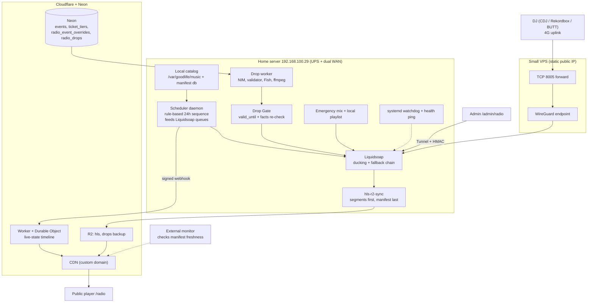

# GOODLIFE Radio 254: Master Engineering Plan (Revision 2)

> **Station name:** from config constant `STATION_NAME` (never typed into prompts or code)
> **Site URL:** from env `SITE_BASE_URL` (currently `https://goodlife.smwhr.space`)
> **Target:** Saturday Nov 7, 2026. Gates open 12:00 noon EAT.
> **Code freeze:** Tue Nov 3, 23:59 EAT. After that, P0 fixes only (section 13.3). Changing event data in the database is not a code change and is always allowed.
> **Status:** Phase 0 database work (lineup columns, `radio_event_overrides`) is reported done on a Neon branch. The production migration is still pending a checkout regression test (section 4).

---

## 0. What changed in this revision

1. **Build order flipped.** Catalog, playout, delivery and failover come first. AI drops come second. A station with good music and generic drops is a success; a station with brilliant drops and dead air is not.
2. **Restored items that Revision 1 dropped:** catalog ingestion and spot-check, the full list of drop types, persona-by-daypart config, queue-time re-validation, the audio production chain, the generic fallback drop library, admin controls, logging and alerts.
3. **New: Drop Gate.** Re-checks event facts right before a drop airs, and still behaves safely when the internet is down.
4. **`time_check` drops are coarse.** Pre-generated clips can't say an exact minute, so they use hour-level phrasing.
5. **Event layer corrected.** Reuses the website's own availability logic, filters `status = 'live'` (not `is_active`), drops the non-existent `slug`, makes `starts_at`/`ends_at` nullable, never selects `subtitle` or `badge_text`.
6. **Liquidsoap sketch corrected.** Real silence failover (`blank.strip`), `mpegts` segments, per-source transitions, no unverified parameters. Manifest timestamps are added by the uploader if Liquidsoap can't.
7. **DJ harbor rewritten.** TCP forward over a WireGuard tunnel that the home server initiates (it is behind CGNAT). Removed the "SHA-256 auth" and "3-second debounce" claims, which the software doesn't do.
8. **Alerts rebuilt.** A box that has lost internet can't send its own alarm, so an external monitor was added and WhatsApp replaced with a simple push channel.
9. **Benchmark fixed.** Candidates come from `/v1/models`, humans rate Sheng quality blind, the latency budget is realistic (pre-generation), the 11B baseline is included.
10. **Hardcoding fixed.** The domain is a config value, not a string. Removed the "link in bio" test clip. Flyer names are not seeded into the plan or code.
11. **BPM folding fixed** so genre rules no longer skip the general fold.
12. **Schedule re-ordered**, with the Sunday Nov 1 Park and Chill used as a real-world soft launch.
13. **Removed overclaims:** "sample-accurate", fixed iOS/hls.js buffer numbers, "custom Kenyan models".

---

## 1. Invariants

1. **Local-first playout, honestly stated.** Playout runs from local disk and does not need Neon, NVIDIA or Fish to keep music on air. If the internet drops, local audio keeps playing and the stream resumes when the connection returns, but online listeners hear a gap during the outage. Mitigations: UPS, dual-WAN router (fibre plus 4G failover), a player that shows "reconnecting" and retries, and an external monitor. A cloud standby station is an after-festival option.
2. **Nothing event-related is hardcoded.** Event names, dates, gate hours, venues, ticket tiers, prices, lineup, ticket URL and station branding come from the database or one config file. These strings must not appear in application code, prompts, fallback drops or docs-as-code, except in clearly marked test fixtures: `Marara`, `Goodlife 4`, `Nov 7`, `Park & Chill`, `Riverfront`, `goodlife.co.ke`, `goodlife.smwhr.space`, `98.4`, and any traffic or route line.
3. **The model never calculates facts.** Code computes dates, countdowns, gate phrases and spoken prices, and sets `valid_until`. The model only writes a short line using those ready-made phrases.
4. **Silence beats a wrong drop.** Any failure, timeout or validator rejection means no drop, or a reviewed generic one.
5. **Lineup is spoken only when `lineup_confirmed = true`.**
6. **Column allowlist.** Never `SELECT *`. Never read or send to a model: `till_number`, `budget_allocated`, `regulations`, `story_media`, `ticker_text`, inventory fields, `badge_text`, `subtitle`.
7. **No unverifiable claims.** No "selling fast", "limited", "sold out soon" or popularity wording unless computed in code from real inventory (section 5.6).

---

## 2. Architecture



---

## 3. Priority tiers (festival is Nov 7)

**MUST, live by the Nov 3 freeze**
- 250 to 300 curated, mastered, spot-checked tracks on local disk, plus the emergency mix
- Liquidsoap playout, 5 s HLS, uploader, R2 and CDN delivery, public player with now-playing
- Failover tests passed, UPS, dual WAN, external monitor, phone alerts
- DJ harbor via VPS, rehearsed on a real mobile uplink
- Event data layer, Drop Gate, Drop Engine v2 core: `event_countdown`, `ticket_push`, `recurring_tease`, `time_check` (coarse), `station_id`, plus `event_now` once `ends_at` is entered
- Generic reviewed drop library (30+)
- Grep and integration tests for hardcoded strings

**SHOULD, by Nov 5 if every MUST is green**
- Admin: Play Next, Mute Auto-DJ, 4-pad cartwall, "festival mode" override of the daypart curve
- `dj_note`, `next_track_tease` for the top 50 tracks with `hook_note`, stingers, drop log and preview/regenerate

**AFTER THE FESTIVAL**
- Public shoutouts with moderation, real listener-city drops, the Vault, cue sheets and ID3, auto-archive of DJ sets, 1,000+ track catalog, 3-candidate generation, HE-AAC, cloud standby station

---

## 4. Database realities and decisions

| Finding | Risk | Decision |
|---|---|---|
| `events.event_date` for the flagship is `2026-11-07 00:00 UTC` (03:00 EAT), a date-only placeholder | Hour-level countdowns would be wrong | Never use it for hours. `radio_event_overrides.gates_open_at = 2026-11-07 12:00:00+03`. Do not edit `event_date`; the website depends on it |
| `sales_close_date` is `2026-11-07 09:00 UTC` = 12:00 EAT | None, and it confirms the noon gate | Test that it equals `gates_open_at`; report any other time found in `custom_schedule_text`, `ticker_text`, `regulations`, flyer |
| Early Bird KES 450 closes `2026-10-30 18:00 UTC` = 21:00 EAT, Advance KES 500 opens then | A stale drop quotes a dead price | `valid_until` plus Drop Gate (sections 5.5, 6.5). Tests inject a fake `now` instead of waiting |
| `badge_text` says "SELLING FAST" while `sold_count` is tiny | False claim on air | Never read `badge_text` |
| Title `SUNDAY PARK & CHILL #12` | Numbering goes stale | Strip `#\d+`, `No. 12`, `Vol 3`; `&` to "and"; natural casing |
| `lineup` and `lineup_confirmed` added to `events` | Announcing unconfirmed acts | Spoken only when confirmed. The owner enters names in the admin editor. The agent seeds nothing |
| `is_active` only controls the homepage default | Using it would drop the Sunday event | Promotable filter uses `status = 'live'`, not `is_active` |
| No `slug`, no coordinates in `events` | Invented values | No slug in the model. Coordinates only from `radio_event_overrides.venue_coords`, entered by the owner |
| Website availability logic exists (`event-availability.ts`) | Radio and checkout could disagree on what is on sale | Radio imports and reuses it. Test equality for every tier at several timestamps |
| Tier dates may be stored as "Kenya time stored as UTC" | Wrong deadlines on air | Timezone audit before building `events.ts`: report how checkout interprets each date column |
| Migration was run on a Neon branch | Production schema unchanged | Apply to production only after checkout, gate scanner and admin editor regression pass. Additive columns only |

---

## 5. Event data layer (`lib/radio/events.ts`)

### 5.1 Queries (allowlist)
```sql
SELECT e.id, e.title, e.venue, e.event_date, e.status, e.category,
       e.recurrence_pattern, e.recurrence_day, e.recurrence_time,
       e.sales_open_date, e.sales_close_date,
       e.lineup, e.lineup_confirmed,
       o.starts_at, o.gates_open_at, o.ends_at, o.radio_priority,
       o.promo_blurb, o.venue_coords, o.spoken_ticket_url
FROM events e
LEFT JOIN radio_event_overrides o ON o.event_id = e.id
WHERE e.status = 'live'
  AND e.archived_at IS NULL
  AND COALESCE(o.radio_promote, true) = true;

SELECT t.id, t.event_id, t.name, t.price, t.sold_count, t.max_quantity,
       t.available_from, t.available_until, t.hidden, t.deleted_at,
       t.show_only_on_event_day, t.hide_on_event_day,
       t.admits_quantity, t.tier_category
FROM ticket_tiers t
WHERE t.event_id = ANY($1);
```
Whether a tier is "on sale" is decided only by the shared website availability function (which handles hidden, soft-delete, event-day rules and sale windows). Radio never reimplements it.

### 5.2 Normalized object
```typescript
export interface RadioTicketTier {
  name: string;
  price: number;
  price_spoken: string;          // "four hundred and fifty shillings"
  admits: number;                // 1, 2, 4, 5
  sale_ends_at: string | null;
  scarcity_phrase: string | null; // only from real inventory, else null
}

export interface RadioPromotableEvent {
  id: number;
  name_spoken: string;           // "Sunday Park and Chill" (no numbering, natural casing)
  venue_spoken: string | null;
  venue_coords: { lat: number; lng: number } | null;
  starts_at: string | null;
  gates_open_at: string | null;
  ends_at: string | null;
  gates_open_phrase: string | null;   // "gates open at noon"
  state: "upcoming" | "live_now" | "sold_out"; // live_now only when ends_at exists
  is_recurring: boolean;
  ticket_url: string;            // SITE_BASE_URL + the site's real event route
  spoken_ticket_url: string;     // from overrides, else "tickets on our site"
  tiers: RadioTicketTier[];      // entry tiers only, on sale now, max 3
  lineup: string[];              // empty unless lineup_confirmed
  promo_blurb: string | null;
  countdown_phrase: string;      // computed in code
  valid_until: number;           // epoch ms
  facts_hash: string;            // SHA-256 of every fact used
  fetched_at: number;
}
```

### 5.3 Date and phrase rules (all in Africa/Nairobi)
- Day-level phrasing only until `gates_open_at` exists. Hour-level phrasing only when it does.
- `"in N days"` beyond 7 days, weekday names within 7 days (`"this Saturday"`), `"tomorrow"`, `"today"` before 18:00 and `"tonight"` after.
- `"happening now"` only when `starts_at` and `ends_at` both exist and now is between them. Until then, use `"gates open at noon"` style phrasing.
- Phrases flip at 00:00 EAT, so any drop using a day-level phrase has `valid_until` no later than the next midnight EAT.
- Recurring events: compute the next occurrence from `recurrence_pattern`, `recurrence_day`, `recurrence_time`. For `biweekly`, an anchor date is required. If none exists, disable biweekly promos and report it. Never infer a schedule from a title.
- Exclude ended events. For one-offs compare `event_date`/`ends_at`; for recurring events compare the next occurrence, not the stored `event_date`.

### 5.4 Spoken formatting
- `speakPrice(450)` returns `"four hundred and fifty shillings"`. Never let TTS read "KES" as letters, and never output digits.
- Strip edition numbers, convert `&` to "and", fix ALL-CAPS titles.
- Pronunciation map (`config/pronunciation.json`): artist names, venue, event names, the spoken domain. Expand it whenever a mispronunciation is heard.
- Ticket link: `SITE_BASE_URL` for text surfaces. Spoken form comes from `spoken_ticket_url`, chosen after hearing three Fish test clips: (a) "goodlife dot S M W H R dot space", (b) "goodlife dot smwhr dot space", (c) "tickets on the Goodlife website". Until chosen, use (c).

### 5.5 `valid_until` and `facts_hash`
`valid_until` is the earliest of: each used tier's `available_until`; the next tier's `available_from` (the price changes there); `sales_close_date`; `gates_open_at`; `starts_at`; `ends_at`; the next midnight EAT if a day-level phrase is used; and generation time + 20 minutes. Example: a drop quoting KES 450 can never air after 21:00 EAT on Oct 30.
`facts_hash` covers every fact in the drop: event name, date phrases, venue, tier names and prices, lineup flag and names.

### 5.6 Scarcity and badges
Scarcity wording is allowed only when `max_quantity` is not null and remaining inventory (`max_quantity - sold_count`) is under a configurable threshold (default 20%). `badge_text` is never used.

### 5.7 Sources of truth when data is missing
- DB timeout 3 s, in-memory cache 30 to 60 s.
- On failure, use the last good snapshot only if it is under 10 minutes old. Otherwise return no events and skip all event drops.
- Missing fields are omitted from the prompt, never defaulted. No default weather, traffic, venue or city.
- Weather and traffic lines only if `venue_coords` exists, validates (lat -5 to 5, lng 33 to 42, within ~30 km of Thika or Nairobi, otherwise warn the owner), and the fetch is fresh. `maps_url` is a search URL and is never parsed for coordinates.

### 5.8 Event selection
Candidates are promotable events starting within a configurable window (default 14 days) plus any `live_now` event. The nearest gets the most airtime and `radio_priority` adjusts it. No candidates means no event drops.

---

## 6. Drop Engine v2

### 6.1 Where it runs
A Node worker on the home server calls Neon, NVIDIA NIM and Fish Audio, validates, masters with ffmpeg, writes the result and a metadata JSON into `/var/goodlife/drops/`, and uploads a copy to R2 `/drops/` for admin preview and backup. Playout reads only local files.

### 6.2 Drop types
Rotate types, never the same type twice in a row, one drop every 3 to 4 tracks (not every transition), skip if the previous drop is under 3 minutes ago.

| Type | Data source | Notes |
|---|---|---|
| `event_countdown` | Event object | Highest priority within the window. Hour phrasing only with `gates_open_at` |
| `ticket_push` | On-sale entry tiers | Max 3 (cheapest plus a group option). Sale-ending urgency only if `available_until` exists. All sold out means skip |
| `recurring_tease` | Next occurrence of a recurring event | "this Sunday" computed in code |
| `event_now` | `live_now` or gates-open window | Needs `ends_at` (or explicit gates time) in the DB |
| `time_check` | Clock plus calendar | Hour-level only. `valid_until` = end of that hour. Never a minute |
| `dj_note` (SHOULD) | Admin free-text with expiry | Overrides conflicting facts |
| `next_track_tease` (SHOULD) | Next track plus `hook_note` | See 6.4 |
| `station_id` | Config | 4 to 8 words, stinger |
| `shoutout` (AFTER) | Approved listener messages | Moderation required |

### 6.3 Persona and mood are chosen in code
`config/radio-personas.json` maps daypart x track energy x drop type to persona, Fish tag set and stinger group. The four existing voices (DJ Shax, MC Cheche, Amina, Wigman) move into this config. No whisper delivery over a late-night banger. The model only writes the line.

### 6.4 Track data used by drops
- `hook_note` (owner-written, top 200 tracks first). Empty means no lyric or catchphrase reference. The model must not invent lyrics.
- `intro_seconds`: word cap is about 2.5 words per second of the available window. `mid_song` drops are disabled unless a marked instrumental window exists.
- A `next_track_tease` carries `target_track_id`. If Play Next or Cut Now changes the next track, the Drop Gate swaps in a generic drop.

### 6.5 Drop Gate (queue-time re-validation)
Runs in the scheduler right before a drop is pushed to `drops_queue`:
1. `now < valid_until`, else discard.
2. If the drop has an `event_id`: re-read the event with a 3 s timeout, recompute `facts_hash`. If it differs (price edit, tier sold out, cancellation, lineup flag changed), discard and use a generic drop.
3. If the DB is unreachable: air the event drop only if its snapshot is younger than `DROP_MAX_STALE_MINUTES` (default 15). Otherwise use a generic drop.
4. If `next_track_tease`: confirm `target_track_id` is still next.
5. Log the decision either way.

### 6.6 Model benchmark (do after the data layer works, about 2 hours)
1. `GET https://integrate.api.nvidia.com/v1/models` with our key. The catalog lists models that aren't callable per account, so send a 1-token test to each candidate and keep only those that answer.
2. Shortlist (test what responds, add strong text-only instruct models you find): `meta/llama-3.3-70b-instruct`, `nvidia/llama-3.3-nemotron-super-49b-v1.5`, `nvidia/nemotron-3-super-120b-a12b`, `nvidia/nemotron-3-nano-30b-a3b`, Mistral small/medium instruct, Qwen instruct, Kimi, gpt-oss. Include the current `meta/llama-3.2-11b-vision-instruct` as the baseline.
3. `scripts/bench-drop-models.ts`: 14 cases x 3 runs per model, using the exact production prompt and validator. Cases: each genre (amapiano, gengetone, drill, afropop, rhumba), each daypart, a `feat.` title, a hard-to-pronounce artist, missing data (no weather, no traffic), plus event cases using real rows and synthetic edge cases: event today, within 48 h, recurring weekly, several tiers, one tier sold out, price null, sale ending soon, lineup confirmed and unconfirmed, a prompt-injection string in `promo_blurb`, no events at all.
4. For reasoning models, disable or strip thinking output and count thinking tokens as latency.
5. Record: median and p95 latency, validator pass rate, `finish_reason=length` rate, preamble leakage, invented-fact rate before the validator, repetition across runs, cost or credits if reported.
6. **Human blind rating by the owner**, 1 to 5 for "sounds like a real Nairobi radio host", model names hidden, in one report with scripts side by side.
7. Decision: highest human score with 95%+ validator pass rate and p95 latency under 8 s (drops are pre-generated, so quality beats speed). Pick the best sub-3 s model as the fallback. `PRIMARY_MODEL` and `FALLBACK_MODEL` are env vars.
8. Also test 3 candidates per call, choosing by validator score, and report whether it is worth the cost.
**Stop and show the report before building the rest.**

### 6.7 Prompt and validator
**Prompt.** The model gets a facts block with only verified fields and ready-made phrases (including `price_spoken`, `countdown_phrase`, `gates_open_phrase`), and is told to copy them exactly and mention nothing else. It also gets the owner's Sheng phrase bank (seed ~30 phrases) and the last 10 scripts as a "do not repeat" list. No fixed example lines. Output is strict JSON `{"tag": "...", "text": "..."}`.
**Fish tags.** Verify valid tags against the Fish docs and test 20 clips before locking the rule. Do not assume `[hype]`, `[whisper]` or `[pause]` exist. The earlier code's "EXACTLY ONE tag" rule contradicted its examples; pick one consistent rule.

**Validator** (retry up to 2 times on the primary model, then 1 on the fallback):
- JSON parses, tag is allowed, `finish_reason` is not `length`.
- No preamble ("Here's...", "Sure"), markdown, emoji, parentheticals or digits.
- Word count within the type's window and the intro-seconds cap.
- Every price, day name, time phrase, venue, event name and artist must match the facts block exactly (prices must equal an allowed `price_spoken` string). Anything not in the facts block is rejected.
- Forbidden strings: any hardcoded-string list from section 1, unconfirmed lineup names, `badge_text` wording.
- Next track and artist are mentioned only when the type requires it, checked after lowercasing, stripping `feat.` and punctuation, and removing stopwords (not the old "any token over 2 characters" check).
- Not too similar to the recent-scripts list (n-gram overlap).

### 6.8 Fish Audio
- Fish is the sole voice provider. Edge-TTS is removed.
- Voices are reference voices (`reference_id` per persona), not "custom Kenyan models". Test Sheng and place-name pronunciation with 20 clips before building around it.
- Verify the model id (`s2.1-pro-free`), free limits and output formats before relying on them. Request WAV or lossless if offered, otherwise MP3 and decode.

### 6.9 Production chain
ffmpeg after Fish: loudnorm to about -14 LUFS integrated (true peak -1 dBFS, check by ear against the music), light compression, optional short slapback, trim head and tail silence, mix with a short stinger or riser (10 to 15 stingers tagged by energy). Drops are standalone files; **Liquidsoap ducks the music live** under the voice. Do not bake drops into track files.

### 6.10 Fallbacks, logging, ops
- Generate 2 to 3 tracks ahead in the background, never in the live path. Timeouts: NIM 8 s, Fish 10 s, R2 8 s, DB 3 s.
- The 4 old hard-coded fallback clips are deleted. Replace with 30+ reviewed generic drops tagged by daypart. They contain no event, venue, date or price. The owner reviews each before it goes live. Never repeat within the last 10 drops.
- Log every drop: type, persona, model, latency, validator failures, retries, fallback used, `event_id`, `facts_hash`, gate decision.
- Admin page: last 50 drops with script, audio, approve and delete, plus "Preview next drop" and "Regenerate".
- Push alerts if fallback rate exceeds 30% over 20 drops, or the event DB, NIM, Fish or R2 fail repeatedly.

---

## 7. Catalog and sequencing

### 7.1 Sources and quality
A 320 kbps file made from a low-quality rip is still low quality. Use files you own or DJ masters. Streaming platform downloads are not a dependable path. The human bottleneck is curation and spot-checking, not CPU. Budget real hours for it.

### 7.2 Ingestion (target 250 to 300 tracks for the festival)
1. Transcode to 320 kbps MP3 (or keep FLAC locally).
2. Trim dead air at the start and end with gentle thresholds so quiet amapiano intros and tails aren't clipped. Two-pass trimming; `silenceremove` needs both start and stop parameters.
3. Two-pass EBU R128 `loudnorm` to -14 LUFS, true peak -1 dBFS (a streaming target, not the -23 LUFS broadcast standard).
4. Extract BPM, Camelot key, energy as **draft** tags. Spot-check in `/admin/radio/catalog`; harmonic tolerances stay wide.
5. Store locally under `/var/goodlife/music/` and write a local manifest database (SQLite or JSON) with cleaned titles, artists, BPM, key, energy, `intro_seconds`, `hook_note`. The scheduler reads this manifest, not Neon.

### 7.3 BPM normalization (fixed)
Do not return early from genre branches. For each track, take candidates `{x/2, x, 2x}` and pick the one that falls inside the genre's window. If none or several qualify, flag **needs review**. Apply the general 85 to 135 fold only to tracks with no genre. Genre windows: amapiano 108 to 115, gengetone and arbantone 90 to 105, drill 140 to 145 (often detected near 70), afropop 100 to 112, afro-tech and deep house 120 to 124, classics and rhumba 95 to 110. Unit test: gengetone detected at 70 is flagged, not silently doubled to 140.

### 7.4 Rule-based sequencer (no runtime LLM)
- Camelot distance at most 1 step (8A to 7A, 8A, 9A or 8B).
- Tempo window +/- 6% per step, relaxed before repeating or going silent.
- No artist repeat within N tracks, no track repeat within 4 hours.
- Daypart energy curve: 06:00-12:00 energy 3 to 5, 12:00-18:00 energy 6 to 8, 18:00-00:00 energy 8 to 10, 00:00-06:00 energy 5 to 7. An admin "festival mode" can override it.
- Precompute 24 hours ahead into `/var/goodlife/schedules/`.

---

## 8. Playout core

### 8.1 Layout
```
/var/goodlife/
  music/ drops/ emergency/ schedules/ recordings/ hls/ logs/ manifest.db
```
`emergency/` holds a 120-minute mix **and** a small playlist of ~20 tracks as a second-level fallback (a single file can be corrupt). The mix needs a source recording; assign this as a task.

### 8.2 Services
- **Scheduler daemon:** keeps 3 tracks of lookahead in `music_queue`, pushes drops from the Drop Gate to `drops_queue`, and sends now-playing events to the Cloudflare Worker (signed webhook).
- **Admin API (local):** small authenticated service in front of Liquidsoap's telnet, which stays bound to 127.0.0.1.
- **systemd watchdog:** restarts Liquidsoap, the scheduler and the uploader.

### 8.3 Liquidsoap (reference sketch)
Pin the installed 2.x version and check each function and parameter name against that version's documentation before use. Do not claim features you haven't confirmed.
```liquidsoap
settings.server.telnet := true
settings.server.telnet.bind_addr := "127.0.0.1"
settings.server.telnet.port := 8004

music_queue = request.queue(id="music_queue")
drops_queue = request.queue(id="drops_queue")

music = crossfade(duration=3.0, music_queue)

# -12 dB duck while a drop plays (p=0.25 is about -12 dB). Parameter names vary by version.
automated = smooth_add(delay=1.0, p=0.25, normal=music, special=drops_queue)

# blank.strip makes a source "unavailable" during silence, so fallback moves on.
automated_safe = blank.strip(max_blank=6.0, threshold=-40.0, automated)

emergency = mksafe(single("/var/goodlife/emergency/festival_emergency_set.mp3"))

# DJ over WireGuard. Bind to the tunnel address only. Password from env, rotated per event.
dj = blank.strip(max_blank=20.0, threshold=-45.0,
  input.harbor("live", port=8005, addr="10.100.0.2",
    password=environment.get("DJ_SOURCE_PASSWORD"), buffer=3.0, max=10.0))

# One transition per source (dj, automated_safe, emergency). Test on the installed version.
station = fallback(track_sensitive=false,
  transitions=[to_dj, to_auto, to_emergency],
  [dj, automated_safe, emergency])

# Alerting only. Never block the audio thread; wrap the alert call in a thread.
station = blank.detect(max_blank=6.0, threshold=-40.0,
  on_blank=fun () -> alert("dead air"), station)

output.file.hls(
  playlist="stream.m3u8", segment_duration=5.0, segments=6, segments_overhead=4,
  "/var/goodlife/hls",
  [("aac_hi",  %ffmpeg(format="mpegts", %audio(codec="aac", b="192k", ar=44100))),
   ("aac_low", %ffmpeg(format="mpegts", %audio(codec="aac", b="64k",  ar=32000)))],
  station)
```
Notes: the 64 kbps variant is AAC-LC, not HE-AAC, unless an HE encoder is confirmed. Verify whether this Liquidsoap version writes `EXT-X-PROGRAM-DATE-TIME`; if not, the uploader inserts it (section 10.1). Also record every harbor session to `/var/goodlife/recordings/` with `output.file` as insurance.

### 8.4 Failover tests that must pass before sign-off
Kill Liquidsoap, pull power (UPS holds), unplug fibre (4G takes over), corrupt the music queue, fill the music queue with silence, drop the DJ stream mid-set, restart the uploader. Each must recover without a human and produce a phone alert.

---

## 9. DJ ingress

- **Network:** the home server is behind CGNAT, so it **initiates** the WireGuard tunnel to the VPS (`PersistentKeepalive = 25`). The VPS forwards public TCP port 8005 over the tunnel to the home Liquidsoap harbor at `10.100.0.2:8005`. This is plain TCP forwarding, so there is no second Icecast to maintain. (A VPS-side relay is the fallback design if forwarding proves unreliable.)
- **Security:** Icecast source authentication is a plain shared password over unencrypted TCP, not SHA-256. Use a long random per-event password, rotate it, keep SSH key-only on the VPS, open only 8005 and the WireGuard port, add rate limiting. The DJ hostname is config, not a hardcoded domain. Make sure its DNS points at the new VPS.
- **Settings for DJs:** MP3 or AAC at 128 to 192 kbps over a cellular uplink (320 is risky), mount `/live`. The DJ should also record locally.
- **Flapping:** Liquidsoap switches back to automation the moment the DJ feed disappears. `buffer=3.0` is only jitter buffering, not a hold timer. Add a hold window (stay on DJ or on the emergency bed for about 10 s after a disconnect before resuming auto) and rehearse it on a real 4G link.
- **Takeover drop:** optional generic "live from the decks" drop through the same ducking path.

---

## 10. Cloudflare delivery and metadata

### 10.1 HLS upload (`hls-r2-sync`)
1. Detect new `.ts` segment, upload to R2 with `Cache-Control: public, max-age=31536000, immutable`.
2. Wait for success.
3. Only then upload the updated variant playlist with `max-age=1`. The master playlist is static.
4. If Liquidsoap doesn't emit `EXT-X-PROGRAM-DATE-TIME`, insert it here from the playout wall clock.
5. Delete remote segments no longer referenced by the playlist. R2 lifecycle rules work in days, so pruning must be done by the uploader.
6. Serve through a **custom domain** with CORS headers for hls.js, not `pub-*.r2.dev` (rate-limited, development only).
7. Compute segment headroom in rehearsal: with 5 s segments and a ~300 ms upload there is plenty of margin, but test on the real uplink.

### 10.2 Live state (Worker + Durable Object)
- The scheduler POSTs track changes to a Worker (HMAC-signed). A Durable Object holds current, recent and next track **with wall-clock UTC start times**. (Plain Worker isolates don't share memory; KV can lag.)
- The public endpoint caches at the edge for 1 to 2 s using `caches.default`.
- One response carries a short timeline (last few tracks plus next), so clients poll every 15 to 30 s and align locally. Expect to need the Workers Paid plan at festival scale (the free tier is 100k requests/day).

### 10.3 Player sync
- The player reads the playhead's wall-clock time from the stream (hls.js `playingDate`, or the native equivalent) and shows the track whose `[start, end)` contains it. Each client therefore matches its own delay. Timing is second-level, not sample-accurate.
- If no new segment arrives for ~30 s, show "reconnecting" and retry. Offer a low-data toggle that picks the 64 kbps variant.
- Admin dual meter: studio time versus measured on-air delay.

---

## 11. Admin control plane (`/admin/radio`)

- **Reach:** Cloudflare Tunnel from the home server plus HMAC-signed requests. Raw TCP (the DJ harbor) does not go through the Tunnel; that is what the VPS is for.
- **Auth and safety:** admin role required. Destructive actions (Cut Now, Mute Auto-DJ) need confirmation and are written to an audit log.
- **MUST:** playout monitor (on-air state, source in use, on-air delay, last 50 drops, alert history).
- **SHOULD:** Play Next, Cut Now (2 s crossfade), Mute Auto-DJ, 4-pad cartwall with ducking, `dj_note` field with expiry, drop preview/regenerate, festival mode.
- **Event editor:** lineup, `lineup_confirmed`, override fields (`gates_open_at`, `starts_at`, `ends_at`, coordinates, spoken URL, promo blurb). Show which events are missing required fields.

---

## 12. Monitoring and alerts

- **External monitor** (outside the home network) checks the public manifest's freshness every minute and the player URL. It is the only thing that can alert if the home box or its internet is dead.
- **Internal checks:** Liquidsoap alive, dead air, uploader lag, disk space, queue depth, drop fallback rate, DB reachability.
- **Channel:** push to the owner's phone (Telegram bot, ntfy or similar), with a second recipient. Not WhatsApp automation.
- **Hardware:** UPS runtime tested under load, dual-WAN router with 4G failover, spare power for the router and modem.

---

## 13. Schedule and gates

### 13.1 Plan (today is Wed Oct 28)
| Date | Work | Done when |
|---|---|---|
| Wed Oct 28 | Event data layer, timezone audit, production-migration regression plan. Start track curation and emergency mix. Provision VPS and WireGuard | `events.ts` tests pass; curation underway |
| Thu Oct 29 | Liquidsoap, local catalog subset, 5 s HLS, uploader, fallback chain. Run the model benchmark in parallel | Station plays from local disk with failover; benchmark report ready |
| Fri Oct 30 | Public player, Worker and Durable Object. Drop Engine core with benchmark winner. Early Bird closes 21:00 EAT | Stream plays on phones. Price-boundary test passes using a fake clock |
| Sat Oct 31 | Harbor takeover rehearsal on a real 4G uplink. Admin monitor. Generic drop library review. Start continuous running as early warning | DJ takeover works and recovers |
| Sun Nov 1 | **Soft launch** during the real Sunday Park and Chill. Watch listener behaviour | A real-world run completes with notes |
| Mon Nov 2 | Fix findings. 20 sample drops approved by the owner. SHOULD items if MUST is green | All MUST items pass their tests |
| Tue Nov 3 | Final grep tests, regression on checkout, **freeze 23:59** | Zero open P0 bugs |
| Wed to Thu, Nov 4 to 5 | 48 h soak on the frozen build | No restarts needed, no dead air |
| Fri Nov 6 | Sign-off (13.2) | Go decision recorded |
| Sat Nov 7 | Broadcast. Gates open 12:00 | |

### 13.2 Go/no-go checklist for Nov 6
- 48 h soak passed with no human intervention
- All failover tests in 8.4 passed, with phone alerts received
- DJ takeover rehearsed on real 4G, set recorded locally
- UPS and 4G failover verified under load
- External monitor firing correctly (test by stopping the uploader)
- Event facts on air match the website for every tier, date and time
- Lineup spoken only if `lineup_confirmed` is true and the list has been reviewed
- Zero hardcoded-string grep hits outside fixtures
- Owner has listened to and approved every generic drop
- Spare 4G router, charged phones and printed runbook on site

### 13.3 After the freeze
Only P0 fixes (broken audio, dead air, wrong facts on air). Every hotfix is tested, recorded in the log, and resets the soak clock for the changed component.

---

## 14. Acceptance tests

- Unit: recurring next-occurrence math, EAT midnight boundaries (23:59 vs 00:01), countdown phrasing at 10 days, 2 days, 5 hours, live now, null price, sold-out tier, hidden and soft-deleted tiers, title normalization (`SUNDAY PARK & CHILL #12` becomes `Sunday Park and Chill`), `speakPrice`, BPM folding.
- Equality: radio on-sale tier list equals checkout's for every tier at several timestamps including just before and after Oct 30 21:00 EAT.
- Integration: change an event name, date and tier price in a test copy of the DB. The next drop reflects all three with zero code changes. A drop generated before the change is discarded by the Drop Gate.
- Validator: rejects an invented price, an invented date, an unconfirmed artist, a prompt-injection string from `promo_blurb`, and a preamble.
- Offline: with Neon unreachable, event drops older than the stale limit are replaced by generic drops, and music never stops.
- Grep: the forbidden strings from section 1 appear only in test fixtures.

---

## 15. Inputs still needed from the owner

- [ ] Real GOODLIFE 4 lineup entered in the admin editor, `lineup_confirmed` flipped only when final (the flyer shows acts, but the agent seeds nothing)
- [ ] `starts_at` and `ends_at` for Nov 7 (gates `12:00` is already set)
- [ ] GPS coordinates for the Nov 7 venue and for Riverfront Garden (long-press in Google Maps)
- [ ] The Sunday event's real hours if they differ from `recurrence_time`, and the biweekly anchor date if used
- [ ] Choice of spoken domain after hearing the three test clips
- [ ] Sheng phrase bank (~30), `hook_note` for the top 50 to 200 tracks, pronunciation corrections
- [ ] Source recording for the 120-minute emergency mix
- [ ] The 250 to 300 curated tracks, and time to spot-check tags
- [ ] Decision on whether the old edition numbers should ever be spoken (current decision: never)
