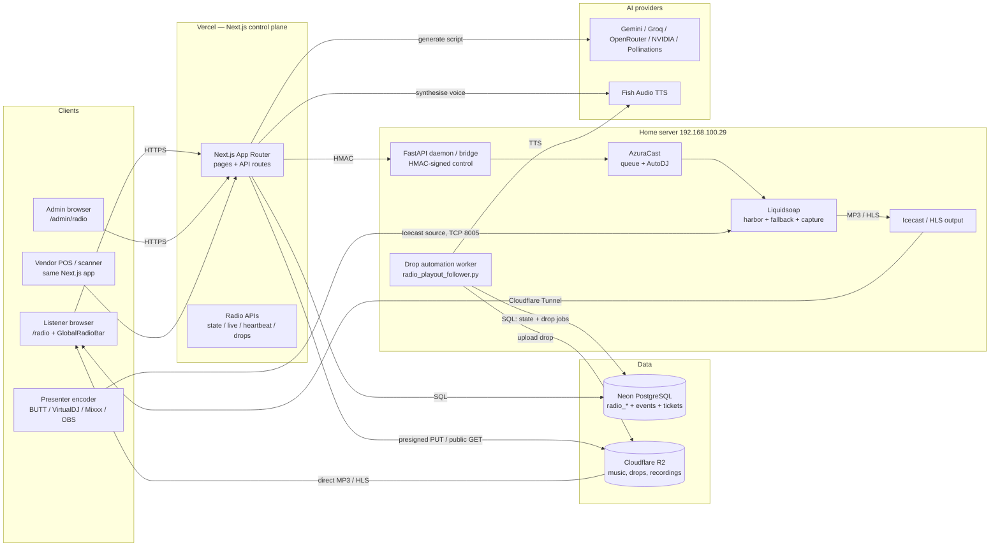
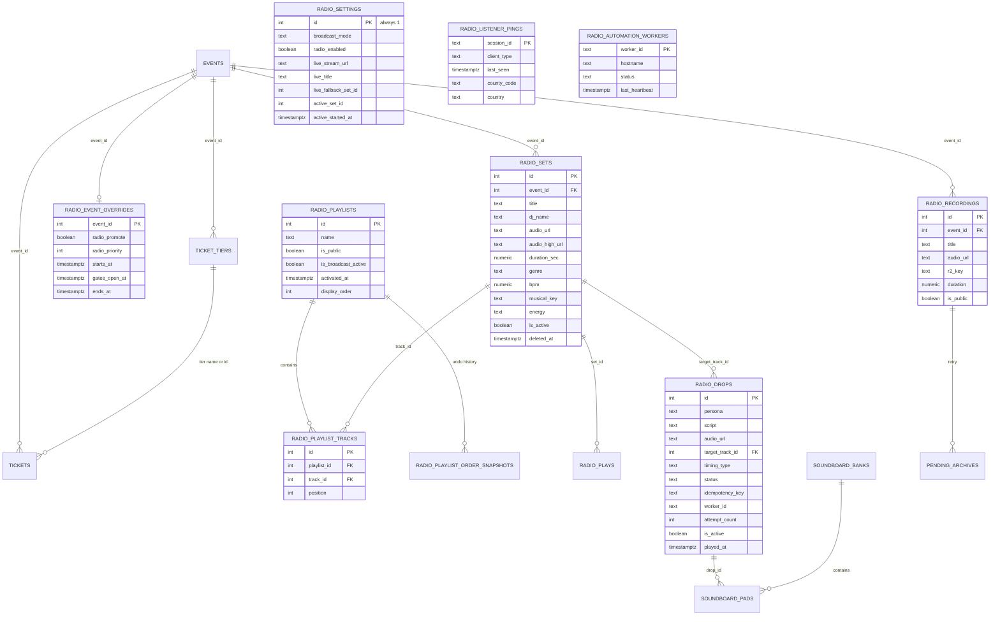
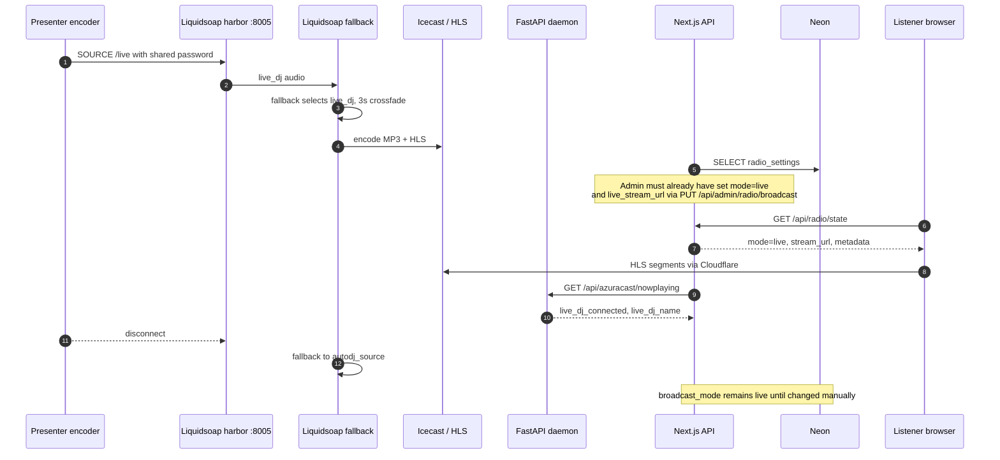

# GOODLIFE Radio — Architecture and Implementation Review

> **Scope:** read-only review of the code in this repository, plus the `home-server/` deployment definition.
> **Date:** 12 November 2026.
> **Rule applied:** code is the source of truth. `README.md`, `CLAUDE.md`, `RADIO-SPECIFICATION.md`, `RADIO-MASTER-PLAN.md` and `RADIO-FIX-PLAN.md` were treated as drift-prone planning material.
> **No application code was changed.** This file is the only new artefact.

---

## 1. Executive summary

GOODLIFE is not a standalone online-radio product. This repository is primarily a festival ticketing and vendor point-of-sale platform (`goodlife-event-tickets`) with a large custom radio module inside it.

The radio module does four things today: it plays a synchronised 24/7 rotation of DJ sets stored in Cloudflare R2; it generates and plays AI presenter drops; it can play a real live HLS stream when an administrator switches the station to `live`; and it archives live sets into a public replay vault. It has a polished listener page and a very large admin console.

It has **no listener-visible show timetable, no presenter accounts, no presenter slot view, and no schedule-driven handover**. Presenters share one Icecast password; the application cannot issue per-presenter credentials or reliably know who is on air. There are also **two independent playout systems** (browser-synchronised R2 tracks and an optional home-server AzuraCast/Liquidsoap stack) that can disagree.

Type checking is clean and the sampled radio checks pass, but the missing presenter/timetable layer and a critical admin-cookie weakness mean this is not yet the platform described in the brief.

### Status at a glance

| Goal | Status | Where it lives |
|---|---|---|
| Listeners can hear a continuous station | ✅ Implemented, but client-side | `context/RadioContext.tsx`, `app/api/radio/state/route.ts` |
| Listener sees a show timetable | ❌ Not implemented | no table, API, page or component |
| Presenter logs in and sees their slots | ❌ Not implemented | no presenter role, auth, or slot model |
| Presenter goes live with VirtualDJ/Mixxx/BUTT/OBS | 🟡 Partial | shared Icecast harbor, `DecksConnectCard.tsx` |
| Automatic handover between presenters | 🟡 Partial, audio-layer only | `home-server/liquidsoap/goodlife-station.liq` |
| AutoDJ fallback | 🟡 Two competing implementations | R2 virtual timeline + Liquidsoap `request.queue` |
| Now-playing metadata | ✅ Implemented | `/api/radio/live`, daemon AzuraCast proxy |
| Recordings and replays | 🟡 Partial, deployment unverified | Liquidsoap capture → daemon → R2 → `radio_recordings` |
| Listener chat, requests, dedications | ❌ Not implemented | no table, route or component |

### Status labels used in this document

- **✅ Implemented** — code exists, is wired to a UI or API, and the main path is coherent.
- **🟡 Partial** — some code or deployment definition exists, but a key part is missing, manual, unverified, or contradicted elsewhere.
- **❌ Not implemented** — no meaningful implementation exists. Planning documents do not count.

---

## 2. Technology stack

| Layer | Technology | Evidence |
|---|---|---|
| Web framework | Next.js 15 App Router, React 19, TypeScript | `package.json`, `app/` |
| Styling | Tailwind CSS v4, custom `@theme` tokens | `app/globals.css`, no `tailwind.config.js` |
| Animation | `motion` | `package.json`, `next.config.ts` `transpilePackages` |
| Database | Neon PostgreSQL via `pg` | `lib/neon-client.ts`, `lib/supabase-db.ts` |
| Hosting | Vercel project `goodlife-event-tickets` | `.vercel/project.json` |
| Object storage | Cloudflare R2, public bucket/domain | `lib/radio/r2-signer.ts`, `R2_*` env names |
| Listener audio | HTML5 `<audio>`, `hls.js` for live | `context/RadioContext.tsx` |
| AI drop generation | Gemini, Groq, OpenRouter, NVIDIA NIM, Pollinations | `lib/radio/drop-engine.ts` |
| Text-to-speech | Fish Audio | `lib/radio/drop-engine.ts` |
| Drop automation worker | Python asyncio daemon that polls the playout transition and pre-generates drops | `scripts/radio_playout_follower.py` (tracked, not in Compose) |
| Music ingest | Invidious / `yt-dlp` bridge | `scripts/radio-bridge-server.py`, `home-server/daemon` |
| Home playout | Docker: AzuraCast + Liquidsoap + FastAPI daemon | `home-server/docker-compose.yml`, `home-server/liquidsoap/` |
| Edge tunnel | Cloudflare Tunnel | `home-server/cloudflared/config.yml` |
| Payments | PayHero STK push (live), Paystack (feature-flagged) | `app/api/payhero/*`, `lib/supabase-db.ts` |
| Messaging | WAHA / WhatsApp gateways | `lib/whatsapp.ts`, `app/api/admin/whatsapp/*` |
| Tests | Standalone `tests/*.check.ts` run with `tsx` | `tests/` |

There is **no Supabase runtime dependency** in `app/`, `lib/` or `components/`, despite the README and `CLAUDE.md`. The Supabase packages and `utils/` remain as vestigial dependencies. Neon is the only database.

There is **no Redis, queue, worker, or job runner**. Long-running work is done inline in API routes or by the separate Python daemon on the home server.

### Plain-language glossary

- **Icecast** — a streaming server. It accepts an audio feed and serves it to many listeners.
- **Liquidsoap** — a playout program. It decides what audio is on air, mixes sources, and feeds Icecast.
- **Harbor** — Liquidsoap's input port that accepts a live presenter's encoder.
- **Mount point** — the named stream path, e.g. `/live`. Encoders and players must use the same mount.
- **AutoDJ** — automatic music playout when no presenter is live.
- **HLS** — HTTP Live Streaming. A playlist of small audio segments that browsers can play over normal HTTPS.
- **R2** — Cloudflare's S3-compatible file storage. The song files and recordings live here.
- **STK push** — the M-Pesa prompt that asks a phone to enter a PIN.
- **HMAC** — a keyed signature. It proves a request came from someone who knows a shared secret.
- **Webhook** — an HTTP callback sent by an external service when something happens.
- **Cron** — a scheduled job. This project triggers one via HTTP, not an in-process scheduler.

---

## 3. System architecture

### 3.1 The two-system reality

The repository contains **two different radio stations** that share a database and a UI:

1. **The Vercel "virtual station"** — the default. There is no continuous audio server. `/api/radio/state` and `/api/radio/live` compute a timeline from `radio_playlists` and `radio_sets`. Each listener's browser downloads the current R2 MP3 and starts it at a calculated offset. Drops are also played locally in each browser. The station sounds continuous because every browser runs the same clock arithmetic against the same playlist activation time.
2. **The home-server "real station"** — optional. `home-server/docker-compose.yml` runs AzuraCast, Liquidsoap and a FastAPI daemon on an Ubuntu machine at `192.168.100.29`. Liquidsoap accepts a live presenter on harbor port `8005`, falls back to AzuraCast's AutoDJ, records the live set, and emits Icecast/HLS. The Vercel app can point the player at that HLS URL when `radio_settings.broadcast_mode = 'live'`.

These systems are not synchronised. The virtual station's playlist position and AzuraCast's queue are separate. The same `radio_settings` row is the only coordination point.

### 3.2 System diagram

### 3.3 What each part does

| Component | Responsibility | Key files |
|---|---|---|
| Next.js on Vercel | Serves public pages, admin console, all JSON APIs; holds the database and provider credentials | `app/`, `lib/` |
| Neon Postgres | System of record for radio settings, catalogue, playlists, drops, telemetry, recordings, events, tickets | `lib/supabase-db.ts`, `lib/neon-client.ts` |
| Cloudflare R2 | Stores full DJ sets, high-bitrate masters, AI drops, soundboard audio, recordings | `lib/radio/r2-signer.ts` |
| FastAPI daemon | Health, AzuraCast proxy, next-track queueing, DIY drop mastering, archive-session, retry pending archives | `home-server/daemon/main.py` |
| Drop automation worker | Claims drop jobs, generates scripts/TTS, uploads to R2, records worker heartbeat | `scripts/radio_playout_follower.py` |
| AzuraCast | Queue and AutoDJ management on the home server | `home-server/docker-compose.yml` |
| Liquidsoap | Live harbor, fallback chain, crossfade, 320 kbps recording tap, drops harbor, ducking, Icecast/HLS output | `home-server/liquidsoap/goodlife-station.liq` |
| Listener player | Synchronised virtual playback, live HLS playback, drop playback, heartbeats | `context/RadioContext.tsx`, `components/radio/GlobalRadioBar.tsx` |
| Admin radio console | Programming, library, drops, soundboard, live credentials, telemetry | `app/admin/radio/page.tsx`, `components/admin/radio/` |

### 3.4 Critical architectural fact

The default station does **not** stream from a server. Every listener independently downloads the same MP3 from R2 and seeks to the same offset. That is cheap to host and needs no always-on audio server, but it is not a broadcast: there is no single stream, no server-side listener count, no server-side ad/drop insertion, and no real-time source. When a presenter is live, the architecture changes to a genuine Icecast/HLS stream, but only if the home server is running and the admin has set the mode correctly.

---

## 4. Folder and module map

| Path | What lives there | Notes |
|---|---|---|
| `app/radio/page.tsx` | Public listener page | Station hero, playlists, vault, event card, up-next/history |
| `app/admin/radio/page.tsx` | Admin radio console | ~1,300 lines; seven tabs |
| `app/api/radio/` | Public radio APIs | `state`, `live`, `heartbeat`, `play-event`, `recordings`, `playlists`, `diagnostics`, `drops/*` |
| `app/api/admin/radio/` | Admin radio APIs | Broadcast settings, mode, library, playlists, queue, drops, soundboard, AzuraCast proxy |
| `app/api/cron/radio-drops/route.ts` | Scheduled drop generation | Bearer `CRON_SECRET` |
| `app/api/webhooks/radio-ingest/route.ts` | Ingest callback from home server | HMAC-signed |
| `components/radio/` | Public player UI | `GlobalRadioBar`, curated playlists, festival vault |
| `components/admin/radio/` | Admin console UI | Rundown, drop studio, soundboard, library, playlists, live decks, telemetry |
| `context/RadioContext.tsx` | Global client playback engine | ~2,700 lines; the heart of the virtual station |
| `lib/radio/` | Server-side radio logic | Config, types, drop engine, event promotion, cron, R2 signing, listener tracking, bridge client |
| `home-server/` | Separate playout deployment | Docker Compose, Liquidsoap, daemon, archiver, Cloudflare tunnel |
| `scripts/` | Ad-hoc operational scripts | Mostly untracked; many hardcode production DB credentials |
| `migrations/` | SQL snapshots | No migration runner |
| `tests/` | Standalone verification scripts | `*.check.ts`, run with `tsx` |

### 4.1 Important file responsibilities

- `lib/radio/config.ts` — station identity, stream defaults, timeouts, feature flags.
- `lib/radio/types.ts` — `RadioSet`, `RadioPlaylist`, `RadioDrop`, playout types.
- `lib/radio/events.ts` — event facts, EAT time helpers, ticket-tier safety, promotion windows, `valid_until`/`facts_hash`.
- `lib/radio/drop-engine.ts` — LLM cascade, script validation, TTS, loudness normalisation, R2 upload, drop gate.
- `lib/radio/cron-engine.ts` — daily cap and target-pool rules for evergreen drops.
- `lib/radio/listener-tracker.ts` — heartbeat upsert and active-listener count.
- `lib/radio/bridge-client.ts` — HMAC-signed calls to the home-server bridge.
- `lib/radio/r2-signer.ts` — presigned uploads, public URLs, multipart support.
- `home-server/daemon/services/archiver.py` — loudnorm, R2 upload, `radio_recordings` insert, `pending_archives` retry.
- `middleware.ts` — the only edge auth gate; matcher is an explicit allowlist.

---

## 5. Data model

There is **no migration runner and no authoritative schema file**. `schema.sql` is a stale Supabase-era snapshot with four tables. The live database has roughly 23 tables. Radio columns were added by one-off scripts in `scripts/` (several of which are gitignored) and by `migrations/*.sql` snapshots. Column lists below are the columns actually referenced by application code, not a guarantee that every column has a clean migration.

### 5.1 Core radio tables

| Table | Purpose | Columns observed in code |
|---|---|---|
| `radio_settings` | Singleton `id = 1` station state | `id`, `broadcast_mode`, `radio_enabled`, `live_stream_url`, `live_title`, `live_fallback_set_id`, `active_set_id`, `active_started_at`, `last_heartbeat`, `updated_at` |
| `radio_sets` | One DJ set / track in the catalogue | `id`, `event_id`, `title`, `dj_name`, `audio_url`, `audio_high_url`, `r2_key`, `r2_high_key`, `cover_url`, `duration`, `duration_sec`, `genre`, `file_size`, `file_size_high`, `bitrate`, `bitrate_high`, `source_type`, `external_id`, `processing_status`, `error_message`, `display_order`, `is_active`, `play_count`, `bpm`, `musical_key`, `energy`, `is_full_set`, `key_source`, `key_confidence`, `bpm_confidence`, `analysis_method`, `analysis_version`, `analyzed_at`, `created_at`, `deleted_at` |
| `radio_playlists` | Ordered rotation / show-length playlist | `id`, `name`, `slug`, `description`, `cover_url`, `genre`, `is_public`, `is_broadcast_active`, `activated_at`, `display_order`, `ingest_job_id`, `ingest_source_url`, `created_at`, `updated_at`, `deleted_at` |
| `radio_playlist_tracks` | Join table with explicit order | `id`, `playlist_id`, `track_id`, `position`, `added_at` |
| `radio_playlist_order_snapshots` | Undo history for harmoniser reorders | `id`, `playlist_id`, `order_json`, `created_at` |
| `radio_drops` | AI / recorded station drops and the drop job queue | `id`, `persona`, `mood`, `title`, `script`, `audio_url`, `target_track_id`, `target_track_title`, `target_artist`, `timing_type`, `play_count`, `played_at`, `is_active`, `status`, `idempotency_key`, `worker_id`, `attempt_count`, `max_attempts`, `claimed_at`, `lease_expires_at`, `last_error`, `completed_at`, `created_at` |
| `radio_plays` | Listener play telemetry | `id`, `set_id`, `session_hash`, `track_title`, `track_artist`, `seconds_listened`, `completed`, `quality_used`, `mode`, `created_at` |
| `radio_recordings` | Archived live sets for the public vault | `id`, `title`, `dj_name`, `audio_url`, `r2_key`, `duration`, `file_size`, `bitrate`, `genre`, `event_id`, `recorded_at`, `is_public`, `created_at` |
| `radio_listener_pings` | Heartbeat sessions and coarse geolocation | `session_id`, `client_type`, `last_seen`, `county_code`, `county_name`, `city`, `country`, `latitude`, `longitude`, `location_updated_at` |
| `radio_automation_workers` | Liveness of Python drop workers | `worker_id`, `hostname`, `service_name`, `status`, `last_heartbeat`, `current_job_id`, `last_error`, `last_error_at`, `last_successful_drop`, `last_successful_upload`, `updated_at` |
| `radio_event_overrides` | Event-driven radio promotion windows | `event_id`, `radio_promote`, `radio_priority`, `starts_at`, `gates_open_at`, `ends_at`, `promo_blurb`, `venue_coords`, `spoken_ticket_url`, `created_at`, `updated_at` |
| `soundboard_banks` | Groups of soundboard pads | `id`, `name`, `display_order`, `created_at` |
| `soundboard_pads` | Individual soundboard buttons | `id`, `bank_id`, `name`, `audio_url`, `drop_id`, `color`, `display_order`, `created_at` |
| `pending_archives` | Retry queue for failed recording archives | `id`, `file_path`, `event_id`, `status`, `attempts`, `error_message`, `created_at` |

**Schema warnings:**

- `radio_drops` has **no complete create-table migration** in the tracked repository. Columns are inferred from `SELECT`/`INSERT` statements in `app/api/radio/*` and `app/api/admin/radio/*`.
- `radio_listener_pings` has **no create-table migration anywhere**. It is only used by `lib/radio/listener-tracker.ts`, and its geolocation columns are added manually.
- `radio_automation_workers` has **no create-table migration**. It is created or altered by the tracked worker's upsert (`scripts/radio_playout_follower.py`) and read by `/api/admin/radio/automation-health`.
- `radio_settings.active_set_id` and `radio_enabled` are used by code but are absent from the earliest radio migration (`scripts/migrate-radio-v3.js`), so they were added manually or by an untracked script.
- `radio_playlists.ingest_job_id` and `ingest_source_url` are queried by `app/api/admin/radio/playlists/route.ts` but are not present in the playlist migration snapshot.

### 5.2 Commerce tables that radio touches

| Table | Relationship to radio |
|---|---|
| `events` | `radio_sets.event_id`, `radio_recordings.event_id`, `radio_event_overrides.event_id`; supplies lineup, venue, dates, ticket tiers |
| `event_details` | Singleton `id = 1` site settings; not an event; source of site metadata |
| `ticket_tiers` | Drop engine reads live tiers and prices to avoid inventing facts |
| `tickets` | Event promotion and gate context; not used by audio playback |
| `pending_payments` | Payment reconciliation; unrelated to playout |
| `vendors`, `vendor_items`, `vendor_operators`, `pos_sales`, `pos_sale_items`, `pos_split_payments`, `customer_tabs`, `tab_transactions` | Vendor POS/tabs; share the database but not the radio flow |
| `event_gallery`, `event_waitlist`, `radio_sets`, `radio_recordings` | Public content surfaces |

Other operational tables present in the live database, but outside the radio path: `payment_logs`, `till_sessions`, `till_pending`, `budget_expenses`, `vendor_event_assignments`, `vendor_items`, `vendor_operators`, `vendors`, `pos_sales`, `pos_sale_items`, `pos_split_payments`, `customer_tabs`, `tab_transactions`, `radio_automation_workers`. The commerce tables are listed by name and purpose only; this review did not attempt to reconstruct every POS column, and `schema.sql` does not contain them.

### 5.3 Entity relationship diagram

### 5.4 How the timeline is stored

The station does not store a queue of "what plays next". It stores:

1. A playlist (`radio_playlists`) marked `is_broadcast_active = true`.
2. An activation timestamp (`activated_at`).
3. An ordered list of tracks (`radio_playlist_tracks.position`).

Every request calculates elapsed time since `activated_at`, divides by the playlist's total duration, and indexes into the ordered tracks. That is why the same track is heard by all listeners at the same approximate moment without a server stream. The calculation lives in `app/api/radio/live/route.ts` and `app/api/radio/state/route.ts`.

`radio_settings.broadcast_mode` selects the behaviour:

| Mode | Player behaviour |
|---|---|
| `autodj` | Virtual R2 timeline (default) |
| `mania` | Virtual R2 timeline, but a single manually chosen set (`active_set_id`) instead of the rotation |
| `live` | HLS stream from `live_stream_url`, falling back to `RADIO_STREAM_URL` |
| `curated` | Treated as non-live; virtual timeline |

`mode` is only ever changed by admin APIs, never by a schedule.

---

## 6. Authentication, roles and permissions

### 6.1 What roles actually exist

| Role | How they authenticate | What they can do | Status |
|---|---|---|---|
| Listener | Nothing | Play the public station, view public playlists and recordings, send heartbeats and play events | ✅ Implemented |
| Presenter / DJ | Nothing dedicated | Connect an external encoder using a shared Icecast password | 🟡 Partial, not an app role |
| Admin | `admin@goodlife.com` + `ADMIN_PASSWORD`, signed cookie | Everything: radio programming, live mode, drops, library, playlists, tickets, vendors, settlements, scanner superuser | ✅ Implemented |
| Vendor | Vendor operator PIN, signed vendor cookie | Own menu, sales, tabs | ✅ Implemented |
| Scanner | Gate PIN, signed scanner cookie | Validate tickets | ✅ Implemented |

There is **no `presenters` table, no presenter login, no presenter cookie, no presenter-specific API, and no presenter page**. “Presenter” exists only as a label on the admin live-decks card and as an Icecast encoder connected to the home server.

### 6.2 Admin authentication

The admin flow is:

1. `POST /api/admin/login` compares the submitted email and password with `admin@goodlife.com` and `ADMIN_PASSWORD` (`app/api/admin/login/route.ts`).
2. On success it creates `goodlife_admin_session=<timestamp>.<payload>.<signature>`, signed with HMAC-SHA256 in `lib/admin-session.ts`.
3. `middleware.ts` protects the matcher paths and `lib/admin-auth.ts` `requireAdmin()` is called inside sensitive route handlers.

The cookie is `httpOnly`, `secure`, `sameSite=lax` in the login route (despite `CLAUDE.md` claiming `strict`), and valid for one day. There are no user accounts, no password hashing, no roles, no audit trail of which admin performed an action, and no 2FA. The same password is reused to confirm permanent deletes and as the scanner superuser bypass.

**Critical legacy path:** both `middleware.ts` and `lib/admin-session.ts` accept the literal cookie value `goodlife_admin_session=true` whenever `ALLOW_LEGACY_ADMIN_COOKIE` is not exactly `"false"`. This is an unsigned bypass. The default is permissive. See section 14.

**Secret fallback:** if `ADMIN_SESSION_SECRET` and `ADMIN_PASSWORD` are absent, session signing falls back to a hardcoded salt in the repository. A deployment with no admin env is therefore not merely “login disabled”; its session tokens are forgeable by anyone who can read the source.

### 6.3 Scanner and vendor sessions

- Scanner: `goodlife_scanner_session`, payload requires `role === "scanner"`, signed with `SCANNER_SESSION_SECRET` (falling back to `TAB_SELF_PAY_SECRET`, `PAYHERO_CALLBACK_TOKEN`, then a hardcoded salt). Gate PIN is `event_details.gate_pin` → `GATE_SCANNER_PIN` → admin password.
- Vendor: `goodlife_vendor_session`, payload requires a `vendorId`, signed with `VENDOR_SESSION_SECRET` (same fallback chain).
- `middleware.ts` verifies signatures at the edge, but route handlers decode the payload without re-verifying it. A `vendorId` taken from a request body is therefore untrusted unless the route is inside the middleware matcher.
- `lib/vendor-tab-auth.ts` lets an admin cookie act as a superuser on customer tabs, so the admin audit drawer can record payments.

### 6.4 Radio API exposure

Radio is **not** a separate auth boundary. It inherits the admin model:

| Surface | Protection |
|---|---|
| `GET /api/radio/state`, `/live`, `/playlists`, `/recordings`, `/diagnostics` | Public, no auth |
| `POST /api/radio/heartbeat`, `/play-event` | Public, no auth, rate limiting is in-memory per instance |
| `POST /api/radio/drops/dynamic`, `/drops/live-inject` | `requireAdmin()` inside the handler |
| `/api/admin/radio/*` | Middleware matcher + `requireAdmin()` |
| `/api/cron/radio-drops` | `Authorization: Bearer CRON_SECRET`, fails closed if unset |
| `/api/webhooks/radio-ingest` | HMAC signature, fails closed if secret missing |

`/api/radio/*` is deliberately **not** in `middleware.ts`'s matcher. Each handler must guard itself. A new radio route is public by default until someone adds a guard.

### 6.5 Permission gaps

- A presenter cannot log in, cannot see their own slots, cannot start or end a show, and cannot update their profile.
- An admin cannot create a presenter or assign a show.
- There is no way to revoke one presenter's stream access; rotating the shared harbor password revokes everyone.
- There is no distinction between “programming” and “live broadcast” permissions. Any admin can inject audio into every listener's browser (`live-inject`) and change the station mode.

---

## 7. Timetable and scheduling

### Status: ❌ Not implemented

There is no show, slot, shift, presenter assignment, recurrence, swap, or timetable model anywhere in the schema or code. There is no listener timetable page, no admin schedule editor, no “next show” API, and no `shows`/`slots` table.

What people may mistake for scheduling:

| Existing thing | What it actually is | Why it is not a timetable |
|---|---|---|
| `radio_playlists` with `is_broadcast_active` and `activated_at` | A continuous music rotation anchored to an activation time | It has no show names, presenters, start/end clock times, or days |
| `radio_settings.broadcast_mode` | A manual station mode (`autodj`, `mania`, `live`) | It is a switch, not a schedule |
| `radio_event_overrides` | Event promotion windows (`starts_at`, `gates_open_at`, `ends_at`) | It controls promotional drops, not presenter shows |
| `lib/radio/events.ts` EAT helpers | Fixed UTC+3 date/time formatting for event facts | It does not model recurring slots or presenter availability |
| `getCurrentDaypart` in the drop engine | Chooses a mood/persona for an AI drop (morning/day/evening) | It is copywriting context, not a show schedule |
| `home-server/README.md` AzuraCast setup | Manual instructions for AzuraCast daypart playlists | Configuration lives outside the app and is not readable by the listener UI |
| `radio_sets.display_order` | Ordering inside the catalogue | It is not a clock schedule |

The consequence is visible in the listener experience: `/radio` shows what is playing and what is next **in the rotation**, but it cannot show “Saturday 20:00–22:00 — DJ X”. A presenter cannot answer “when am I on air?” from the product; that information exists only in someone's head or an external chat group.

### What a real timetable needs

At minimum:

- `presenters` (identity, display name, bio, avatar, stream key).
- `shows` (title, description, genre, cover, default duration, recurrence).
- `show_slots` (show_id, presenter_id, starts_at, ends_at, status, substitute_presenter_id).
- Timezone handling: store UTC, render Africa/Nairobi (EAT, no DST).
- A public `GET /api/radio/schedule` and a listener timetable view.
- A presenter `GET /api/presenter/slots` and an admin schedule editor.
- Conflict detection and a swap/cover request flow.

None of these exist today.

---

## 8. Live streaming flow

### 8.1 Two listening modes

| Mode | Audio path | Who computes “now playing” | Status |
|---|---|---|---|
| Default (`autodj` / `mania` / `curated`) | Browser downloads the current R2 MP3 and seeks to the shared offset | Next.js APIs calculate the timeline from the active playlist | ✅ Implemented |
| `live` | Browser plays HLS from the home server | AzuraCast/Liquidsoap, proxied through the daemon | 🟡 Partial; requires a separately deployed home server |

### 8.2 The virtual station (default)

1. `app/api/radio/state/route.ts` loads `radio_settings`, the active playlist, its ordered tracks, public playlists, event overrides and drops. It returns a payload containing `mode`, `sets`, `playlist`, `drops`, `listeners_count`, and a 24/7 schedule-shaped list built from the rotation.
2. `app/api/radio/live/route.ts` computes the current position: elapsed seconds since `activated_at`, modulo the playlist duration, then walks the ordered tracks to find `now_playing`, `up_next` and recent `history`.
3. `context/RadioContext.tsx` receives the track and starts an `<audio>` element at the reported offset. It keeps a local clock and adjusts on drift.
4. Drops are returned with the state and played by the browser at their target position. There is no server-side audio insertion; each browser plays its own copy.
5. The browser sends a heartbeat to `POST /api/radio/heartbeat`. `lib/radio/listener-tracker.ts` upserts `radio_listener_pings` and counts sessions seen in the last 40 seconds.
6. Playback telemetry is posted to `POST /api/radio/play-event` and written to `radio_plays`.

There is a **third copy of the playout math** in `lib/radio/broadcast-state.ts`, exposed as `GET /api/radio/playout-state`. The Python drop worker polls that endpoint for a `transition_id` and uses it to decide when to pre-generate an intro drop. The listener page uses `/api/radio/state` and `/api/radio/live`, which have their own implementations. The three calculations agree in principle but are separate code paths.

This is a **synchronised download-and-seek system**, not a stream. It scales by letting R2 serve files directly, but it cannot guarantee sample-accurate sync, cannot count actual stream connections, and cannot do server-side live inserts.

### 8.3 The live station

1. A presenter configures an encoder (BUTT, VirtualDJ, Mixxx, OBS, or hardware) with:
   - host `live-dj.darajadigital.com` (or the LAN address `192.168.100.29`),
   - port `8005`,
   - mount `/live`,
   - user `source`,
   - the shared harbor password.
2. Liquidsoap's `input.harbor` accepts the source. `home-server/liquidsoap/goodlife-station.liq` defines the harbor user and password from `HARBOR_USER` / `HARBOR_PASSWORD`, and an auth callback that accepts only that pair.
3. Liquidsoap's fallback chain is `fallback([live_dj, autodj_source, emergency_track])` with a 3-second crossfade. When the harbor disconnects, playout returns to `autodj_source`.
4. `autodj_source` is a `request.queue` fed by AzuraCast. AzuraCast's clock wheels/dayparts are configured on the home server, not in this repository's application code.
5. Liquidsoap feeds Icecast/HLS. The daemon proxies AzuraCast's now-playing data; `app/api/admin/radio/health/route.ts` exposes `live_dj_connected` and `live_dj_name` from that data.
6. The admin must set `radio_settings.broadcast_mode = 'live'` and a `live_stream_url`. The listener page then attaches `hls.js` (or native HLS on Safari) to that URL.
7. When the presenter disconnects, Liquidsoap falls back to AutoDJ automatically, but the app's `broadcast_mode` **stays `live`** until an admin changes it. That is acceptable only because the HLS stream continues with AutoDJ; if the home server dies, there is no app-level state transition.

### 8.4 Sequence diagram — presenter goes live

### 8.5 Credentials and identity

| Question | Current answer | Status |
|---|---|---|
| How does a presenter get credentials? | An admin reads them from the Live DJ Decks card and shares them out of band | 🟡 Manual |
| Are credentials per presenter? | No. One shared harbor user/password for the whole station | ❌ Not implemented |
| Can the app revoke one presenter? | No. Rotating the password revokes all | ❌ Not implemented |
| Does the app know who is live? | Only a boolean and an encoder-supplied display name from AzuraCast | 🟡 Indirect |
| Is the stream encrypted? | Raw Icecast source over TCP; no TLS by default | 🟡 Deployment-dependent |
| Can a presenter start a show from the app? | No. They start their encoder externally; an admin must switch the station mode | ❌ Not implemented |

The Live DJ Decks card (`components/admin/radio/DecksConnectCard.tsx`) contains a **hardcoded default harbor password**. Because it is a client component, that default is compiled into the public JavaScript bundle. The password is also displayed on screen. Section 14 treats this as critical.

### 8.6 Handover between presenters

There is no application-level handover. Liquidsoap handles source changes at the audio layer: when a source disconnects, the fallback chain selects AutoDJ; when a new source connects, it selects the live source again. There is no scheduled handover, no “next presenter is waiting” state, no overlap/crossfade between two presenters, and no check that the person connecting is the person scheduled. If two presenters connect to the same mount, behaviour depends on Liquidsoap/Icecast and is not modelled by the app.

### 8.7 AutoDJ fallback

There are **two AutoDJs**:

1. **App virtual AutoDJ** — the R2 playlist timeline. This is what almost every listener hears today.
2. **Home-server AutoDJ** — AzuraCast's queue, played by Liquidsoap's `request.queue`. This is what listeners hear during a `live` broadcast when no presenter is connected.

They read different state and can play different tracks. Nothing reconciles them. If the product goal is “one station, one now-playing truth”, this is the most important design decision to settle (section 16).

### 8.8 Now-playing metadata

- Virtual mode: computed by `app/api/radio/live/route.ts` from playlist position and track metadata.
- Live mode: `app/api/admin/radio/azuracast/nowplaying/route.ts` proxies the daemon, which proxies AzuraCast. The public `/api/radio/live` also tries the daemon and falls back to the virtual timeline.
- The admin header (`components/admin/radio/RadioHeader.tsx`) shows AzuraCast now-playing with a fallback to `/api/radio/live`, and offers a skip control.

Metadata is therefore **mode-dependent and can be stale or contradictory**. There is no single source of truth for “what is on air right now”.

### 8.9 Recordings and replays

1. Liquidsoap records the live harbor input at 320 kbps into `/var/goodlife/recordings/pending` (`goodlife-station.liq`).
2. On disconnect, `home-server/liquidsoap/on-disconnect.sh` posts the file to the daemon's `/api/internal/archive-session`.
3. `home-server/daemon/services/archiver.py` applies EBU R128 loudness normalisation (about -14 LUFS), uploads to R2, inserts a `radio_recordings` row, and writes failures to `pending_archives` for retry.
4. The public `GET /api/radio/recordings` reads `radio_recordings`; `components/radio/FestivalSetVault.tsx` renders the vault.

Status: 🟡 **Partial**. The code path is coherent, but it depends on the home server actually running, on the mount existing, on the daemon being reachable, and on R2 credentials being correct. None of that is verified by this repository's tests. There is no app-level “recording started/stopped” indicator and no guarantee that a failed archive is retried successfully.

---

## 9. Listener experience

### 9.1 What a listener gets

| Feature | Behaviour | Status |
|---|---|---|
| Public station page | `/radio` — hero, live/tape toggle, now playing, up next, history, event card, playlists, vault | ✅ Implemented |
| Persistent player | `components/radio/GlobalRadioBar.tsx` survives navigation across the public site | ✅ Implemented |
| Play / pause / volume | Standard controls, persisted state | ✅ Implemented |
| Seek | Available in the virtual timeline; live HLS is not seekable | ✅ Implemented |
| Keyboard shortcuts | Play/pause and volume shortcuts | ✅ Implemented |
| Share | Native share / copy link | ✅ Implemented |
| Playlists | Curated public playlists with covers and track lists | ✅ Implemented |
| Replay vault | Public archive of live sets | 🟡 Implemented, depends on archive pipeline |
| Event promotion | Event card, countdown, ticket CTA, AI drops | ✅ Implemented |
| Listener count | Collected internally; not a reliable public “X listening” number | 🟡 Partial |
| Show timetable | None | ❌ Not implemented |
| Presenter profiles | None | ❌ Not implemented |
| Chat / requests / dedications | None | ❌ Not implemented |
| “Now playing” from a real stream | Only in live mode; otherwise computed from the virtual timeline | 🟡 Mode-dependent |

### 9.2 The player's two personalities

`context/RadioContext.tsx` is the single playback engine used by the public page, the global bar, and the admin transport. It supports:

- **Virtual mode** — fetch a track, set `currentTime` to the server-computed offset, play, and correct drift.
- **Live mode** — attach an HLS stream with `hls.js`, or native HLS on Safari.
- **Drop playback** — fetch a drop URL and play it over or between tracks, locally in that browser.
- **Heartbeat / telemetry** — report presence and play events.

It also contains a large amount of queue, history, and UI state. At roughly 2,700 lines it is one of the main maintainability risks in the repository.

### 9.3 What the listener cannot do

- Cannot see which presenter is on air or when their favourite show starts.
- Cannot message the studio, request a song, or send a dedication.
- Cannot browse shows by day or presenter.
- Cannot subscribe to a show or get a reminder.
- Cannot download a live set unless it has already been archived and made public.
- Cannot choose a quality level or force a fallback stream in the UI.

These are product gaps, not hidden features.

---

## 10. Presenter dashboard

### Status: ❌ Not implemented

There is no `/presenter` route, no presenter login, no presenter layout, no presenter API, and no presenter-specific component. A search across `app/`, `components/`, `lib/` and `middleware.ts` finds no presenter role or session.

The closest thing is the **Live DJ Decks** card inside the admin console, which is admin-only and only displays connection settings. It does not show a schedule, a profile, a show history, or a “go live” button.

### What a presenter can do today

1. Ask an admin for the shared Icecast host, port, mount, username and password.
2. Configure an external encoder.
3. Connect.
4. Ask an admin to switch the station to `live` (and hope the HLS URL is configured).
5. Disconnect when done.

That is the entire workflow. It is functional for a trusted internal DJ with a direct line to the admin, but it is not a presenter product.

### What is missing

| Capability | Status |
|---|---|
| Presenter account and login | ❌ |
| “My shows” / slot list | ❌ |
| Show detail, notes, expected duration | ❌ |
| Personal stream key / password | ❌ |
| One-click “go live” or encoder preset download | ❌ |
| Live status (“you are on air”, duration, listener count) | ❌ |
| Handover / next presenter indicator | ❌ |
| Swap or cover request | ❌ |
| Show history and recordings | ❌ |
| Profile, bio, social links, avatar | ❌ |
| Upload a pre-recorded show | 🟡 Admin can upload to the library, but not as a presenter |

---

## 11. Admin panel and radio console

### 11.1 Radio console

`app/admin/radio/page.tsx` (about 1,300 lines) is the station control room. Its tabs are defined in `components/admin/radio/ConsoleSidebar.tsx`:

| Tab | Main components | What it does | Status |
|---|---|---|---|
| **Studio** | `OnAirRundown`, `DropStudio`, `CueDock`, `PerformanceSoundboard`, `QueueNextTrack`, `DecksConnectCard` | Current rotation, manual “play now”, AI drop generation, cue/preview, soundboard, next-track control, live credentials | ✅ Implemented |
| **Drops** | `AiDropGenerator`, `DropManagerPanel` | Generate, audition, assign, activate/deactivate drops | ✅ Implemented |
| **Library** | `LibraryIngestDock`, library manager | Upload audio to R2, ingest from YouTube/SoundCloud via the bridge, edit BPM/key/energy, analyse, harmonise | ✅ Implemented |
| **Playlists** | `PlaylistManager` (about 2,500 lines) | Create playlists, auto-create from rules, reorder, activate broadcast, analyse, harmonise, undo | ✅ Implemented |
| **Live** | `DecksConnectCard` | Shared encoder settings and connection health | 🟡 Partial |
| **Telemetry** | logs / diagnostics panels | Play history, listener pings, drop counts, API logs | ✅ Implemented |
| **Configuration** | `RadioOverridesEditor` | Event promotion windows, priority, spoken ticket phrase, lineup confirmation | ✅ Implemented |

`components/admin/radio/RadioHeader.tsx` sits above the tabs and shows now-playing, a live indicator, and a skip control. `RadioConsoleLayout.tsx` provides the shell and transport.

### 11.2 Critical admin UI gaps

- The **Live** tab only renders `DecksConnectCard`. There is no form to set `broadcast_mode`, `live_stream_url`, `live_title`, or `live_fallback_set_id`.
- `handleSaveLiveBroadcast` exists in `app/admin/radio/page.tsx`, but it is never rendered. It is dead code.
- Even if it were rendered, it sends `POST /api/admin/radio/broadcast`, while the route only exports `GET` and `PUT` (`app/api/admin/radio/broadcast/route.ts`). The save would return 405.
- `POST /api/admin/radio/mode` accepts only `mania` or `autodj`. It cannot put the station into `live`.
- `components/admin/radio/BroadcastConsole.tsx` exists but is not mounted anywhere. It is unused code.

So the only ways to go live today are: call `PUT /api/admin/radio/broadcast` manually with an admin cookie, or update `radio_settings` directly in the database. The UI does not expose it.

### 11.3 Broader admin surface

The same admin session also controls:

- `/admin/dashboard` — events, tickets, tiers, trash, vendors, settlements, metrics.
- `/admin/scanner` and `/scanner` — gate scanning.
- `/admin/vendors` — vendor CRUD, operators, login-as, analytics.
- `/admin/settlements` — commission and payout reconciliation.
- `/admin/gallery` — event gallery.
- `/admin/whatsapp` — WAHA pairing and test messages.
- `/admin/budget` — event budget and expenses.

Radio is therefore one module in a much larger operations console, not a standalone product.

---

## 12. API reference

### 12.1 Auth legend

| Label | Meaning |
|---|---|
| **Public** | No application auth. May still be rate-limited. |
| **Admin** | `goodlife_admin_session` cookie; middleware plus `requireAdmin()` |
| **Vendor** | `goodlife_vendor_session` cookie |
| **Scanner** | `goodlife_scanner_session` cookie or admin |
| **Cron** | `Authorization: Bearer CRON_SECRET` |
| **HMAC** | Signature over the raw body |
| **Token** | HMAC token in the URL or query string |

### 12.2 Public radio APIs

| Method | Path | Purpose |
|---|---|---|
| GET | `/api/radio/state` | Full public state: mode, settings, active playlist, tracks, public playlists, drops, listener count |
| GET | `/api/radio/live` | Now playing, up next, history, mode, stream URL; proxies live metadata when available |
| GET | `/api/radio/playlists` | Public curated playlists |
| GET | `/api/radio/playlists/[id]` | One public playlist with tracks |
| GET | `/api/radio/recordings` | Public replay vault |
| GET | `/api/radio/diagnostics` | Counts and station state for debugging; currently public |
| GET | `/api/radio/playout-state` | Authoritative timeline: transition ID, current, next, upcoming drop, listener count |
| GET | `/api/radio/radar` | Aggregated listener map: counties, diaspora, totals |
| POST | `/api/radio/heartbeat` | Upsert a listener heartbeat with coarse geolocation |
| GET | `/api/radio/heartbeat` | Active listener count |
| POST | `/api/radio/play-event` | Record playback telemetry |
| POST | `/api/radio/drops/dynamic` | Generate/select a dynamic drop |
| POST | `/api/radio/drops/live-inject` | Admin-only: inject a drop into all listeners' browsers |

### 12.3 Admin radio APIs

All routes below require an admin session unless stated otherwise.

| Method | Path | Purpose |
|---|---|---|
| GET, PUT | `/api/admin/radio/broadcast` | Read or update `radio_settings` (mode, stream URL, title, fallback set) |
| GET, POST | `/api/admin/radio/mode` | Read mode; switch between `autodj` and `mania` only |
| GET | `/api/admin/radio/health` | Daemon health, `live_dj_connected`, `live_dj_name` |
| GET | `/api/admin/radio/automation-health` | Latest worker heartbeat, drop job, failures and listener count |
| GET | `/api/admin/radio/azuracast/nowplaying` | Proxy AzuraCast now-playing |
| GET | `/api/admin/radio/azuracast/queue` | Proxy AzuraCast queue |
| DELETE | `/api/admin/radio/azuracast/queue/[id]` | Remove a queued item |
| POST | `/api/admin/radio/azuracast/skip` | Skip current track / advance |
| GET, POST, DELETE | `/api/admin/radio/drops` | List, create, delete drops |
| POST | `/api/admin/radio/drops/generate` | Generate a script/audio drop |
| POST | `/api/admin/radio/drops/diy` | Upload and master a DIY mic drop |
| POST | `/api/admin/radio/drops/fire` | Mark a drop as played / on air |
| POST | `/api/admin/radio/drops/upload` | Upload drop audio |
| GET, POST | `/api/admin/radio/drops/write-script` | Generate or rewrite a drop script |
| GET | `/api/admin/radio/drops/context` | Event/listener context for drop generation |
| GET, PATCH, DELETE | `/api/admin/radio/library` | List, edit, delete catalogue tracks |
| POST | `/api/admin/radio/library/harmonize-all` | Harmonise the whole library |
| POST | `/api/admin/radio/library/harmonize-batch` | Harmonise a selected batch |
| POST | `/api/admin/radio/batch-ingest` | Batch ingest remote tracks |
| POST | `/api/admin/radio/multipart` | Multipart upload orchestration |
| POST | `/api/admin/radio/register-upload` | Register an uploaded object in the catalogue |
| GET, POST | `/api/admin/radio/queue` | Read or modify the bridge/AzuraCast queue |
| GET, POST | `/api/admin/radio/queue-next` | Queue the next track / set |
| GET, POST, PATCH | `/api/admin/radio/playlists` | List, create, update playlists |
| POST | `/api/admin/radio/playlists/auto-create` | Build a playlist from rules |
| GET, PUT, DELETE | `/api/admin/radio/playlists/[id]` | Read, update, delete one playlist |
| POST | `/api/admin/radio/playlists/[id]/activate` | Make a playlist the broadcast rotation |
| GET, POST | `/api/admin/radio/playlists/[id]/analyze` | Analyse tracks in a playlist |
| POST | `/api/admin/radio/playlists/[id]/harmonize` | Propose a harmonic reorder |
| POST | `/api/admin/radio/playlists/[id]/harmonize/apply` | Apply a proposed reorder |
| POST | `/api/admin/radio/playlists/[id]/harmonize/undo` | Revert a reorder |
| POST | `/api/admin/radio/playlists/[id]/tracks` | Add tracks to a playlist |
| DELETE | `/api/admin/radio/playlists/[id]/tracks/[trackId]` | Remove a track |
| GET | `/api/admin/radio/playlist-preview` | Preview a playlist |
| GET, POST, DELETE | `/api/admin/radio/playlist` | Legacy single-playlist operations, including `play_now`, `reorder` |
| GET | `/api/admin/radio/search` | Search the library / remote sources |
| GET | `/api/admin/radio/logs` | Telemetry and drop logs |
| GET | `/api/admin/radio/jobs/[id]` | Ingest/analysis job status |
| GET, POST | `/api/admin/radio/overrides` | Event promotion overrides |
| GET | `/api/admin/radio/soundboard` | Banks and pads |
| POST | `/api/admin/radio/soundboard/banks` | Create a bank |
| PATCH, DELETE | `/api/admin/radio/soundboard/banks/[id]` | Edit/delete a bank |
| POST | `/api/admin/radio/soundboard/pads` | Create a pad |
| PATCH, DELETE | `/api/admin/radio/soundboard/pads/[id]` | Edit/delete a pad |
| POST | `/api/admin/radio/soundboard/reorder` | Reorder pads |

### 12.4 Scheduled and machine APIs

| Method | Path | Auth | Purpose |
|---|---|---|---|
| GET, POST | `/api/cron/radio-drops` | Cron | Generate evergreen drops under daily cap/pool rules |
| POST | `/api/webhooks/radio-ingest` | HMAC | Accept a finished set from the home server, insert `radio_sets`, queue it |

### 12.5 Platform APIs (complete route inventory)

The radio module shares the app with ticketing, vendors and operations. Route families are listed once; subresources use `[id]`.

| Area | Methods and paths | Auth |
|---|---|---|
| Admin auth | `POST /api/admin/login`, `POST /api/admin/logout`, `GET /api/admin/me` | Public (login/logout/me) |
| Admin events | `GET, POST /api/admin/events`; `GET, PUT, DELETE /api/admin/events/[id]`; `POST /api/admin/events/[id]/archive`; `GET /api/admin/events/[id]/vendors` | Admin |
| Admin tickets | `GET, POST /api/admin/tickets`; `GET, PUT, DELETE /api/admin/tickets/[id]`; `GET, POST /api/admin/scan/[ticketId]`; `GET /api/admin/gate-scanner`; `POST /api/admin/gate-scanner` | Admin / scanner |
| Admin payments | `GET, POST, DELETE /api/admin/pending-payments`; `POST .../approve`; `POST .../reject`; `GET, DELETE /api/admin/payment-logs`; `GET /api/admin/paystack/settlements`; `GET .../totals`; `GET .../transactions`; `POST /api/admin/notify-operators`; `POST /api/admin/send-whatsapp`; `POST /api/admin/till-sessions/[id]/force-close`; `GET /api/admin/till-sessions` | Admin |
| Admin vendors | `GET, POST /api/admin/vendors`; `GET, PUT, PATCH, DELETE /api/admin/vendors/[id]`; `GET, POST, PATCH, DELETE /api/admin/vendors/[id]/operators`; `GET, POST, PATCH /api/admin/vendors/[id]/pin`; `GET, POST, PATCH, DELETE /api/admin/vendors/[id]/items`; `GET, PATCH, DELETE /api/admin/vendors/[id]/categories`; `GET, PATCH /api/admin/vendors/[id]/analytics`; `POST /api/admin/vendors/[id]/login-as` | Admin |
| Admin settlements | `GET, POST /api/admin/settlements`; `POST /api/admin/sales/[saleId]/void` | Admin |
| Admin budget | `GET, POST /api/admin/budget`; `GET, POST /api/admin/expenses`; `PUT, DELETE /api/admin/expenses/[id]`; `POST /api/admin/expenses/bulk` | Admin |
| Admin content | `GET, POST /api/admin/r2`; `DELETE /api/admin/r2`; `POST /api/admin/presigned-url`; `POST /api/admin/upload-image`; `POST /api/admin/upload-video`; `GET /api/admin/waitlist`; `POST /api/admin/waitlist/broadcast`; `GET /api/admin/trash`; `POST /api/admin/trash/clear`; `POST /api/admin/verify-simulator-password` | Admin |
| Admin WhatsApp | `GET /api/admin/whatsapp/qr`; `GET /api/admin/whatsapp/status`; `GET /api/admin/whatsapp/test`; `POST /api/admin/whatsapp/test`; `POST /api/admin/whatsapp/restart` | Admin |
| Public events | `GET /api/events/active`; `GET /api/events`; `GET, POST /api/events`; `GET /api/event-details`; `GET, PUT /api/event-details` | Public read / admin write |
| Public tiers | `GET /api/ticket-tiers`; `GET, POST /api/ticket-tiers`; `PUT, DELETE /api/ticket-tiers/[id]` | Public read / admin write |
| Public tickets | `GET /api/tickets/[id]`; `GET /api/tickets/[id]/download`; `POST /api/tickets/lookup`; `POST /api/tickets/rsvp-free` | Public, token/PIN/rate-limited |
| Public payments | `POST /api/payhero/initialize`; `GET /api/payhero/verify`; `POST /api/payhero/callback`; `GET /api/payhero/reconcile`; `POST /api/payments/till-submit`; `POST /api/paystack/initialize`; `GET /api/paystack/verify`; `POST /api/paystack/callback` | Public / provider callback |
| Tab self-pay | `GET, POST /api/pay/tab/[id]` | HMAC token `t` |
| Public hubs | `GET, POST, DELETE /api/hub/gallery`; `GET, POST, DELETE /api/hub/radio`; `POST /api/hub/waitlist` | Public read / admin write / public waitlist |
| WhatsApp | `POST /api/whatsapp/webhook` | Gateway webhook |
| Vendor auth | `POST /api/vendor/auth`; `POST /api/vendor/logout`; `GET /api/vendor/session` | Vendor |
| Vendor catalogue | `GET, POST /api/vendor/items`; `PUT, DELETE /api/vendor/items/[id]`; `GET, PATCH, DELETE /api/vendor/categories` | Vendor |
| Vendor selling | `GET /api/vendor/sales`; `DELETE /api/vendor/sales/[saleId]`; `POST, DELETE /api/vendor/sales/[saleId]/void`; `POST /api/vendor/checkout`; `GET /api/vendor/customers`; `GET /api/vendor/expenses` | Vendor |
| Vendor tabs | `GET, POST /api/vendor/tabs`; `GET /api/vendor/tabs/[id]`; `POST .../[id]/close`; `POST .../[id]/pay`; `PATCH .../[id]/limit`; `POST .../[id]/remind`; `POST /api/vendor/tabs/remind-all` | Vendor / admin superuser |
| Vendor till | `GET /api/vendor/till/current`; `POST /api/vendor/till/open`; `POST /api/vendor/till/close` | Vendor |
| Vendor M-Pesa | `GET /api/vendor/mpesa/status`; `POST /api/vendor/mpesa/stk` | Vendor (public status carve-out) |
| Scanner | `POST /api/scanner/auth`; `POST /api/scanner/logout`; `GET, PATCH /api/scanner/session`; `GET /api/scanner/stats` | Scanner |

**Route total:** 156 `route.ts` files under `app/api`, plus one `route.tsx` for Open Graph images. This table is at route-family level; each `[id]` may expose several methods on the same file.

---

## 13. Deployment and infrastructure

### 13.1 Web application

| Item | Detail |
|---|---|
| Host | Vercel project `goodlife-event-tickets` |
| Build | `npm run build` (`next build`); this is the only full typecheck |
| Fast typecheck | `npx tsc --noEmit` |
| Lint | `npm run lint`; baseline is red with pre-existing problems (37 at the last documented check) |
| Database | Neon PostgreSQL, one pool per server process or per-call pools in some routes |
| Storage | Cloudflare R2, public domain plus presigned uploads |
| Scheduled jobs | No `vercel.json` cron is committed; `/api/cron/radio-drops` must be triggered by an external scheduler with `CRON_SECRET` |
| CI/CD | None in the repository; deployment is manual `vercel --prod` |

I ran `npx tsc --noEmit` during this review: it exited **0**. I also ran eight radio check scripts (`radio`, `radio-playback`, `radio-listeners`, `radio-playlists`, `radio-events`, `cron-radio-drops`, `radio-command-deck`, `drop-engine`): all exited **0**. Those tests are largely source-contract and math checks; they do not exercise a browser, a real home server, R2, or the live stream.

### 13.2 Home server

`home-server/docker-compose.yml` defines:

| Service | Role | Ports |
|---|---|---|
| `azuracast` / web | AzuraCast admin and API | `8055`, `8443` |
| Liquidsoap station | Harbor ingest, fallback, recording, Icecast/HLS | `8005`, `8000` |
| Daemon | FastAPI bridge, health, queue, archive | `8060` (internal/compose network) |

The deployment assumes an Ubuntu host at `192.168.100.29`. `home-server/cloudflared/config.yml` routes public hostnames such as `dj.darajadigital.com`, `invidious-bridge.darajadigital.com` and `radio-api.darajadigital.com` through a Cloudflare Tunnel.

A separate Python worker, `scripts/radio_playout_follower.py`, is **not defined in `docker-compose.yml`**. It is documented as a supervised companion daemon on the same host. It reads `DATABASE_URL`, polls `APP_URL/api/radio/playout-state`, claims rows in `radio_drops`, calls Fish Audio, uploads to R2, and writes `radio_automation_workers` heartbeats. Although most of `scripts/` is gitignored, this particular file is tracked; it is still absent from the deployment definition, which makes it easy to miss.

**Important networking fact:** Icecast harbor source is raw TCP on port `8005`. An HTTP Cloudflare Tunnel does not publish it. Presenter connectivity needs a separate TCP route, router port-forward, VPN, or Tailscale. The repository documents the port-forward option; it does not verify that it is configured.

### 13.3 Environment variables (names only)

No values are reproduced here.

**Core web**

`DATABASE_URL`, `APP_URL`, `NODE_ENV`, `DISABLE_HMR`, `NEXT_PUBLIC_SITE_URL`, `SITE_BASE_URL`.

**Admin and session security**

`ADMIN_PASSWORD`, `ADMIN_SESSION_SECRET`, `ALLOW_LEGACY_ADMIN_COOKIE`, `SCANNER_SESSION_SECRET`, `VENDOR_SESSION_SECRET`, `GATE_SCANNER_PIN`, `SIMULATOR_PASSWORD`, `TAB_SELF_PAY_SECRET`, `PAYHERO_CALLBACK_TOKEN`.

**Radio control**

`RADIO_BRIDGE_URL`, `RADIO_BRIDGE_LAN_URL`, `RADIO_BRIDGE_SECRET`, `RADIO_UPSTREAM_URL`, `RADIO_STREAM_URL`, `NEXT_PUBLIC_RADIO_STREAM_URL`, `RADIO_DROPS_DAILY_CAP`, `RADIO_DROPS_TARGET_POOL`, `RADIO_ALERT_PHONE`, `CRON_SECRET`.

**Home server**

`HARBOR_USER`, `HARBOR_PASSWORD`, `HARBOR_PORT`, `DROPS_HARBOR_USER`, `DROPS_HARBOR_PASSWORD`, `ICECAST_SOURCE_PASSWORD`, `GOODLIFE_RADIO_SECRET_KEY`, `AZURACAST_ADMIN_PASSWORD`, `CLOUDFLARE_TUNNEL_ID`, `BRIDGE_SECRET`, `INVIDIOUS_URL`, `AUTODJ_URL`, `WEBHOOK_URL`, `YTDLP_BIN`, `R2_*`.

**Cloudflare R2**

`R2_ACCOUNT_ID`, `R2_ACCESS_KEY_ID`, `R2_SECRET_ACCESS_KEY`, `R2_BUCKET_NAME`, `R2_PUBLIC_DOMAIN`, `NEXT_PUBLIC_R2_DOMAIN`.

**AI and TTS**

`GEMINI_API_KEY`, `GROQ_API_KEY`, `GROQ_API_KEY_FALLBACK`, `OPENROUTER_API_KEY`, `NVIDIA_API_KEY`, `POLLINATIONS_API_KEY`, `FISH_AUDIO_KEY`, `FISH_AUDIO_API_KEY`, `TOMTOM_API_KEY`.

**Payments and messaging**

`PAYHERO_API_KEY`, `PAYHERO_ACCOUNT_ID`, `PAYHERO_CALLBACK_TOKEN`, `PAYHERO_INTERNAL_TOKEN`, `PAYHERO_MIN_BALANCE`, `PAYSTACK_SECRET_KEY`, `PAYSTACK_PUBLIC_KEY`, `NEXT_PUBLIC_ENABLE_PAYSTACK`, `WHATSAPP_GATEWAY_URL`, `WHATSAPP_API_KEY`, `WHATSAPP_SESSION_ID`, `WAHA_BASE_URL`, `WAHA_API_KEY`, `WAHA_SESSION_ID`, `WHATSAPP_WEBHOOK_SECRET`, `OPERATOR_WHATSAPP_NUMBERS`, `IMGBB_API_KEY`.

### 13.4 Observability

| Signal | Exists? | Notes |
|---|---|---|
| Typecheck | ✅ | `tsc --noEmit` |
| Unit/source checks | ✅ | `tests/*.check.ts` |
| Radio diagnostics endpoint | ✅ | `/api/radio/diagnostics`, public |
| Admin health | ✅ | `/api/admin/radio/health` |
| Structured logs | 🟡 | Console logs; telemetry is partly in-memory |
| Error tracking | ❌ | No Sentry or equivalent |
| Uptime monitoring | ❌ | No probe committed |
| Real listener metrics | ❌ | Heartbeat sessions, not Icecast connections |
| Alerting | 🟡 | WhatsApp operator alerts for selected events |
| Backups / disaster recovery | ❌ | No backup or restore procedure in the repository |

### 13.5 Single points of failure

- Neon database.
- Vercel deployment and its serverless region.
- Cloudflare R2 and the public domain.
- The home server's power, internet, Docker daemon and disk.
- The Cloudflare Tunnel.
- The FastAPI bridge/daemon.
- Each AI/TTS provider in the drop cascade.
- One shared Icecast credential.

There is no documented failover for the home server. In live mode, if it goes down, the listener player must fall back to the virtual timeline; whether that happens cleanly depends on the client error path and is not covered by tests.

---

## 14. Security review

### 14.1 Ranked findings

| # | Severity | Finding | Evidence | Impact | Required fix |
|---|---|---|---|---|---|
| 1 | **Critical** | Unsigned legacy admin cookie is accepted by default | `middleware.ts`, `lib/admin-session.ts`: `goodlife_admin_session=true` accepted while `ALLOW_LEGACY_ADMIN_COOKIE !== "false"` | Anyone can forge an admin session and control tickets, vendors, settlements, radio mode and live drop injection | Set `ALLOW_LEGACY_ADMIN_COOKIE=false` in every environment; reject unsigned values; fail closed when no session secret exists; rotate the admin password |
| 2 | **Critical** | Hardcoded shared Icecast source password in a client component | `components/admin/radio/DecksConnectCard.tsx` default harbor password | The password is in the public JS bundle and on screen; anyone can connect and broadcast over the station, or hold the mount open | Rotate immediately; remove from client code; never display the secret; issue per-presenter credentials |
| 3 | **Critical** | Admin-only `live-inject` can push an arbitrary audio URL into every listener's browser | `app/api/radio/drops/live-inject/route.ts`; called from the admin Drop Studio | With finding #1 it is unauthenticated; even authenticated, a compromised admin can broadcast arbitrary content | Require admin plus an allowlist of R2/approved URLs; log every injection; add a confirmation and audit trail |
| 4 | **High** | No per-presenter credentials and no revocation | `DecksConnectCard.tsx`; `home-server/liquidsoap/goodlife-station.liq` accepts one user/password | One leaked password compromises the whole station; no attribution; rotating it locks out every presenter | Per-presenter stream keys, show-scoped authorization, revocation and expiry |
| 5 | **High** | Bridge auth bypass for multipart and FFmpeg paths | `scripts/radio-bridge-server.py` middleware returns `call_next` for `multipart/form-data` and `/api/radio/ffmpeg/*` before checking HMAC | If the bridge is reachable through the tunnel, unauthenticated uploads/CPU work are possible | Remove the bypass; authenticate every route; keep the bridge off the public internet or behind Cloudflare Access |
| 6 | **High** | Raw Icecast source is unencrypted | `goodlife-station.liq` harbor on `8005`; README port-forward instructions | Credentials and audio can be sniffed on the network | TLS-terminating proxy or VPN/Tailscale; firewall to known presenter IPs where practical |
| 7 | **Medium** | Public heartbeat and play-event endpoints can inflate counts and fill tables | `app/api/radio/heartbeat/route.ts`, `play-event/route.ts`; rate limiting is per-instance in-memory | Fake “listeners”, noisy analytics, storage growth | Signed/session-bound heartbeats, stronger rate limits, retention policy, anomaly detection |
| 8 | **Medium** | Public diagnostics leak station internals | `app/api/radio/diagnostics/route.ts` has no guard | Exposes library counts, settings and mode to anyone | Require admin, or return only a minimal health payload publicly |
| 9 | **Medium** | R2 objects are public and directly hotlinkable | `lib/radio/r2-signer.ts` public URL helpers; uploads store public URLs | All music, drops and recordings can be downloaded or embedded elsewhere; cost and copyright exposure | Private bucket plus signed playback URLs; short TTLs; separate public/private prefixes |
| 10 | **Medium** | No admin audit identity | Single shared admin password; console logs only | Cannot tell who changed mode, deleted a track or injected a drop | Admin accounts, per-user sessions, append-only audit log |
| 11 | **Medium** | No CSRF tokens on state-changing admin calls | Cookie sessions; `sameSite=lax` | Lax blocks most cross-site POSTs but is not a complete CSRF defence, especially with legacy cookie paths | CSRF tokens or strict origin checks on admin mutations |
| 12 | **Medium** | Secrets have appeared in git history | Hardcoded harbor default; old HMAC fallback referenced in plans | Removal from HEAD does not invalidate them | Rotate every exposed secret; document the rotation; do not rely on deletion |
| 13 | **Low** | `live_stream_url` is admin-controlled and played by every listener | `radio_settings.live_stream_url` | An admin can point listeners at an arbitrary third-party stream, leaking IPs and content | Restrict to approved hosts; validate on save |
| 14 | **Low** | AI prompt inputs include event facts and listener context | `lib/radio/drop-engine.ts`, `lib/radio/events.ts` | Prompt injection could produce incorrect or unsafe copy; cost abuse if an admin session is stolen | Validate generated copy, cap spend, keep prompts server-side, log usage |
| 15 | **Low** | No external error tracking or alerting for stream failure | No Sentry/uptime config | Outages are discovered by listeners | Add uptime checks and alerting (section 17) |

### 14.2 What is already good

- Admin session cookies are HMAC-signed, `httpOnly` and `secure`; the legacy path is the exception, not the design.
- `timingSafeEqual` is used for tab self-pay tokens.
- Cron and ingest endpoints fail closed when their secrets are missing.
- The WhatsApp gateway module deliberately sanitises upstream errors and does not leak the WAHA URL or API key.
- Public API routes are explicitly separated from admin routes, even though the matcher is an allowlist that needs care.
- `next.config.ts` sets security headers.

None of these compensate for findings #1–#3.

---

## 15. Gaps against the stated goals

| Goal from the brief | Current reality | Status |
|---|---|---|
| Listeners listen live | They hear a synchronised R2 rotation, or HLS when an admin has switched to live | 🟡 Partial |
| Listeners see a show timetable | No timetable model or UI | ❌ |
| Presenters log in | No presenter role or login | ❌ |
| Presenters see their slots | No slots exist | ❌ |
| Presenters go live with VirtualDJ/Mixxx/BUTT/OBS | Works with a shared harbor credential and an external encoder, but an admin must switch mode | 🟡 Partial |
| Presenter streams reach the station server | Liquidsoap harbor on the home server, if deployed and reachable | 🟡 Partial, unverified |
| Automatic handover between shows | Liquidsoap source fallback only; no schedule or identity | 🟡 Partial |
| AutoDJ fallback | Two competing AutoDJs | 🟡 Partial, inconsistent |
| Now-playing metadata | Computed in virtual mode; AzuraCast in live mode | ✅ |
| Recordings and replays | Code path exists; deployment unverified | 🟡 Partial |
| Listener chat / requests | None | ❌ |
| Admin can run the station | Yes, but live mode is not exposed in the UI | 🟡 Partial |

---

## 16. Technical debt and risks

### 16.1 Architecture debt

1. **Two playout systems.** The R2 virtual timeline and the AzuraCast/Liquidsoap stack are independent. They have different queues, different now-playing, different listener counts, and different failure modes. Every feature must decide which one it means.
2. **No presenter or schedule domain.** The core product model is missing. Adding it later touches routing, auth, the database, the player, the admin console and the home server.
3. **No migration runner.** Schema changes are one-off scripts, some untracked. `radio_drops` and `radio_listener_pings` have no create-table migration in the repository. Rebuilding the database from source is not possible with confidence.
4. **No single source of truth for live state.** `broadcast_mode`, the actual harbor connection, the AzuraCast streamer name and the client's HLS state can disagree.
5. **Client-side broadcast semantics.** Drops play in each browser; there is no server-side insertion, no ad logging, and no guarantee that every listener hears the same drop at the same time.
6. **No real listener metrics.** Heartbeats count browser sessions, including studio monitors, and can be inflated. The public radar (`/api/radio/radar`) derives counties from Vercel geolocation headers, so it is an approximate engagement map, not a stream-audience measurement.
7. **Three playout implementations.** `app/api/radio/state/route.ts`, `app/api/radio/live/route.ts` and `lib/radio/broadcast-state.ts` each re-implement the playlist offset/manual-mode calculation. They can drift, and only the last one is used by the drop worker.
8. **A worker outside the deployment definition is part of the runtime.** `scripts/radio_playout_follower.py` owns the drop job state machine (`PENDING` → `CLAIMED` → `SYNTHESIZING` → `MASTERING` → `UPLOADING` → `READY`/`FAILED`) and the `radio_automation_workers` heartbeat. It is tracked, but absent from `docker-compose.yml` and from the documented deployment steps.

### 16.2 Code debt

| File | Size / symptom | Risk |
|---|---|---|
| `lib/supabase-db.ts` | ~150 KB isomorphic data layer with `typeof window` branches | Hard to test, easy to add inconsistent queries |
| `context/RadioContext.tsx` | ~2,700 lines | Playback, queue, drops, analytics and UI state in one module |
| `components/admin/radio/PlaylistManager.tsx` | ~2,500 lines | UI and business rules tightly coupled |
| `app/admin/radio/page.tsx` | ~1,300 lines | Seven tabs, many handlers, dead live-save code |
| `app/admin/dashboard/page.tsx` | ~262 KB | Ticketing, tiers, trash, events, vendors, settlements in one page |
| `app/vendor/sell/page.tsx` | ~135 KB | POS flow in one page |
| `components/admin/VendorDetailDrawer.tsx` | ~186 KB | Customer audit in one component |

Other code issues:

- `BroadcastConsole.tsx` is unused.
- `handleSaveLiveBroadcast` is dead and would hit a 405 if wired.
- `POST /api/admin/radio/mode` cannot select `live`.
- `app/api/radio/state/route.ts` has inconsistent default modes (`autodj` in one branch, `live` and `curated` in others).
- In-memory rate limits and caches reset on cold start and do not coordinate across serverless instances.
- Many handlers use broad `catch {}` and silently degrade, which hides data corruption.
- Documentation (`README.md`, `CLAUDE.md`) describes Supabase, Paystack as primary, Netlify, and a different build setup; none match the code.

### 16.3 Operational risks

- The home server is a single physical point of failure with no documented failover.
- The public stream depends on a Cloudflare Tunnel whose configuration is not verified by application tests.
- No backup or restore procedure for Neon or R2.
- No error tracking; failures are discovered by users.
- Presenter onboarding is manual and depends on an admin being awake.
- Rotating the harbor password requires contacting every presenter.

### 16.4 Legal and content risks

- **Music licensing:** there is no rights, licence, territory, ISRC or royalty field in `radio_sets`, and no reporting. Ingesting tracks from YouTube/SoundCloud via Invidious/`yt-dlp` and storing them in R2 is a copyright risk unless the station has explicit rights.
- **Public recordings:** archived sets are downloadable from a public vault. That may be intended for festival promotion, but it is also redistribution of any music in the set.
- **AI voice cloning:** Fish Audio can synthesise presenter-style voices. Consent, disclosure and voice-rights rules are not represented in code.
- **AI-generated factual claims:** the drop engine validates some facts (`facts_hash`, event gate), but generated copy can still make claims about lineups, prices or times. Human review is not enforced.

---

## 17. Prioritised recommendations

### P0 — this week (security and correctness)

1. **Close the admin bypass.** Set `ALLOW_LEGACY_ADMIN_COOKIE=false`; remove the `"true"` acceptance path; require `ADMIN_SESSION_SECRET` and fail closed if it is absent; rotate `ADMIN_PASSWORD`, the harbor password, `RADIO_BRIDGE_SECRET`, `CRON_SECRET`, and any token that has ever been in git. Add an audit log for admin mutations.
2. **Remove the hardcoded harbor credential from the client.** Delete the default password from `DecksConnectCard.tsx`; never render the secret; issue credentials server-side. Rotate the current password first, because it is already in the bundle and git history.
3. **Make live mode operable.** Add a real Live settings form; change the save call to `PUT`; allow `live` in the mode endpoint; show the current mode and stream URL on the Live tab; delete or wire `BroadcastConsole.tsx`.
4. **Restrict `live-inject`.** Accept only approved R2 URLs, require a confirmation, and log the admin, URL and time. Do not allow arbitrary remote audio.

### P1 — next 2–6 weeks (the missing product)

5. **Add the presenter and schedule domain.** Minimum tables: `presenters`, `shows`, `show_slots`. Minimum flows: admin creates presenter and slot; presenter logs in; presenter sees “my shows”; public `/radio/schedule` shows the timetable in EAT; “next show” appears on `/radio`.
6. **Per-presenter stream credentials.** Generate a stream key per presenter or per slot; authorize it in Liquidsoap (auth hook to the app/daemon); expire it after the slot; support revocation. This also gives you “who is live” for free.
7. **Choose one playout architecture.** Do not keep adding features to both. Recommended: use AzuraCast/Liquidsoap as the audio source of truth for live and AutoDJ, and keep Next.js as the control plane, timetable, drop engine and listener UI. Keep the R2 virtual timeline only as an explicit offline fallback. See the options below.
8. **Replace the listener count.** Read Icecast/AzuraCast listener statistics from the daemon; keep heartbeats for engagement, not for “X listening”. Exclude studio/admin sessions.
9. **Harden recordings.** Add a recording status indicator, retry/alert on `pending_archives`, a retention policy, and a public/private flag that is enforced by the API.
10. **Add observability.** Uptime checks for `/`, `/radio`, the HLS URL and the daemon; error tracking; alerts to operators when the harbor or archive fails.

### Architecture options and trade-offs

| Option | What it means | Pros | Cons |
|---|---|---|---|
| **A. Adopt AzuraCast fully** | AzuraCast becomes the station: streamer accounts, schedule, AutoDJ, statistics, recording; Next.js becomes portal and admin skin | Mature radio features; per-streamer accounts; real scheduling and stats; fewer custom moving parts | Migration work; PHP/AzuraCast operations; less direct control over custom AI drops; still a home-server dependency |
| **B. Keep the virtual station** | Continue with R2 timeline and browser playback; add presenter portal around it | Cheapest; no always-on audio server; existing UI works | Not a real broadcast; no server-side drops; sync drift; no genuine handover or listener stats; hard to support live presenters |
| **C. Hybrid, then converge** | AzuraCast/Liquidsoap for live and AutoDJ; Next.js for timetable, presenters, drops, admin; R2 virtual timeline only as fallback | Best listener experience now; keeps custom AI/brand; clear migration path to A | Two systems until converged; more operations; requires discipline about which is authoritative |

**Recommendation:** choose **C** for the next quarter and converge toward **A** if the station is a real product rather than a festival side-feature. Option B cannot satisfy the “presenters go live and hand over on a timetable” goal without effectively rebuilding a streaming server in the browser.

### P2 — this quarter

11. **Listener interaction:** chat, song requests, dedications, presenter messages, with moderation and rate limits. This is a product decision, not just code.
12. **Schema and code consolidation:** introduce a migration runner (Drizzle, Prisma or plain numbered SQL with a runner), reconstruct `radio_drops`/`radio_listener_pings`, and split the largest modules.
13. **Rights management:** licence metadata, takedown workflow, recording permissions, AI voice consent.
14. **Admin accounts:** replace the single shared password with named accounts, roles and 2FA.
15. **Resilience:** backup/restore drills for Neon and R2; a documented fallback if the home server is offline.

---

## 18. Open questions

1. Is the home server actually deployed and reachable today, and is `live-dj.darajadigital.com:8005` open to presenters? The repository defines it but cannot prove it.
2. Is `ALLOW_LEGACY_ADMIN_COOKIE=false` set in production, and is `ADMIN_SESSION_SECRET` set? If not, the platform is currently open.
3. Is the product a real 24/7 station, or a promotional player for festivals? This determines whether AzuraCast is worth the operational cost.
4. How many presenters are there, and are they trusted staff or external contributors? Per-presenter keys and onboarding depend on this.
5. Are shows recurring weekly, one-off, or seasonal? Do presenters need swaps, cover, and recurring exceptions?
6. Which system should own “now playing”: the R2 timeline or AzuraCast? They currently disagree.
7. Are YouTube/SoundCloud-ingested tracks licensed for broadcast and public replay? If not, the ingest pipeline is a legal liability.
8. Should live recordings be public by default, or opt-in per show?
9. Is listener chat/requests in scope for the next release, or is it explicitly out of scope?
10. What is the expected concurrent audience? That decides whether browser-synchronised R2 playback is acceptable or a real CDN/HLS stream is required.
11. Who is on call when the stream or archive fails, and where should alerts go?
12. Is there budget for a managed streaming provider, or must this stay self-hosted on the home server?

---

## Appendix A — Verification performed in this review

| Check | Result |
|---|---|
| `npx tsc --noEmit` | Exit 0 |
| `tests/radio.check.ts` | 60/60 passed |
| `tests/radio-playback.check.ts` | 54/54 passed |
| `tests/radio-listeners.check.ts` | Passed |
| `tests/radio-playlists.check.ts` | 45/45 passed |
| `tests/radio-events.check.ts` | Passed (live DB section skipped by design) |
| `tests/cron-radio-drops.check.ts` | 26/26 passed |
| `tests/radio-command-deck.check.ts` | 6/6 domains passed |
| `tests/drop-engine.check.ts` | 27/27 passed |
| Real browser / HLS / harbor / R2 / daemon | **Not tested** |

## Appendix B — Documents that disagree with the code

| Document | Claim | Reality |
|---|---|---|
| `README.md` | Supabase + Neon dual database; Paystack primary; Netlify deploy | Neon only; PayHero primary; Vercel |
| `CLAUDE.md` | `output: "standalone"`; Netlify/Railway; no test suite | No standalone output; Vercel; `tests/*.check.ts` exist |
| `RADIO-SPECIFICATION.md` | Describes presenter/handover behaviour as if implemented | Most of it is not implemented |
| `RADIO-MASTER-PLAN.md` / `RADIO-FIX-PLAN.md` | Planning and audit notes | Useful context, not current state |
| `AGENTS.md` | Warns that `radio.darajadigital.com` is a separate project | Consistent with code; do not route radio through it |

---

*End of document.*
