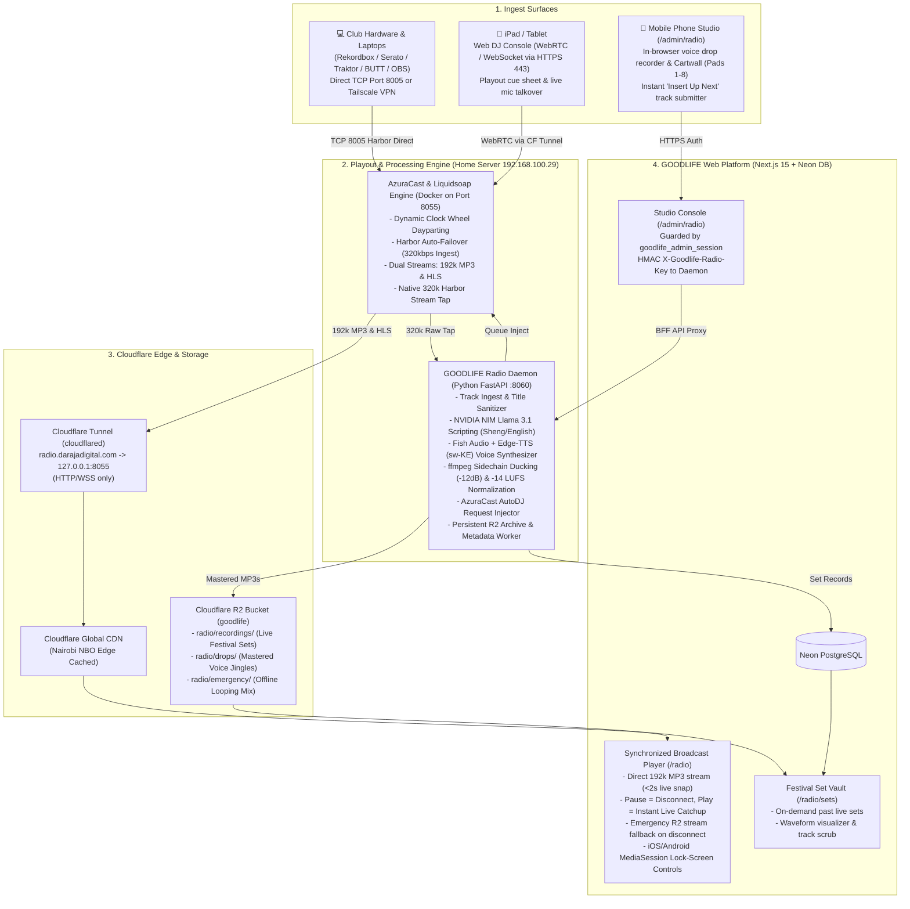
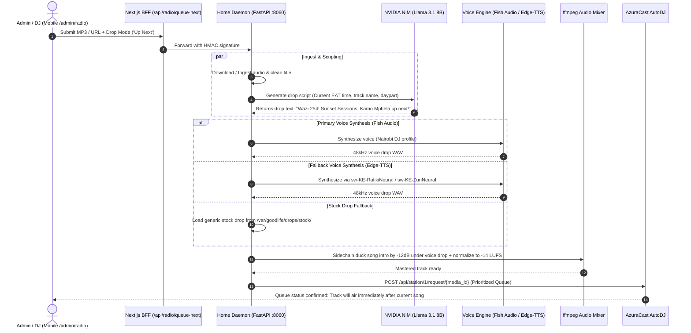
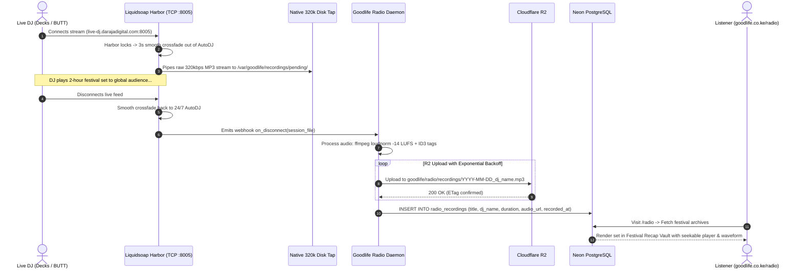

# GOODLIFE Radio 254: Definitive Master Engineering Specification (v7.1 Fixed)

> **Document Type:** Master System Architecture & Implementation Specification  
> **Status:** Production-Ready Reference (Incorporating All Fixes from Engineering Review)  
> **Date:** October 2026  
> **Infrastructure Targets:**
> - **Playout Engine:** AzuraCast + Liquidsoap (`192.168.100.29` Ubuntu Home Server via Docker)
> - **Ingress:** Direct TCP Port 8005 / Tailscale VPN for Live Decks; Cloudflare Tunnel for Web/APIs
> - **Playout Streams:** 192kbps MP3 (Primary, low-latency snap-to-live) + HLS (4s segments fallback)
> - **Edge & Storage:** Cloudflare CDN (Nairobi NBO edge cache) + Cloudflare R2 (`goodlife` bucket)
> - **Web Platform:** Next.js 15 App Router (Vercel) + Neon PostgreSQL
> - **AI DJ Copywriter:** NVIDIA NIM (`meta/llama-3.1-8b-instruct`)
> - **Voice Synthesizer:** Fish Audio API + Edge-TTS (`sw-KE-RafikiNeural` / `sw-KE-ZuriNeural` fallback)

---

## 1. High-Level System Architecture



---

## 2. Dynamic Rotation & Clock Wheels (Nairobi Dayparts)

Instead of static looping playlists, GOODLIFE Radio 254 runs on dynamic **Clock Wheels** aligned with Nairobi time (UTC+3 / EAT).

### 2.1 Daypart Schedule

| Time (EAT) | Daypart Name | Musical Profile | Drop Persona & Language |
|---|---|---|---|
| `06:00 – 10:00` | **Nairobi Sunrise** | Chill Amapiano, Afro-Soul, Soulful House | Smooth, melodic Female Swahili & English |
| `10:00 – 15:00` | **The Goodlife Daily** | Upbeat Afrobeats, Gengetone, High Energy | Upbeat, witty Sheng DJ banter |
| `15:00 – 19:00` | **Sunset Sessions** | Park & Chill vibes, Deep House, Afro-Tech | Laid-back festival hype, sunset countdowns |
| `19:00 – 02:00` | **Quiver Madness** | Peak Amapiano, Club Bangers, DJ Live Sets | Energetic club hype, heavy bass drops |
| `02:00 – 06:00` | **The Afterhours** | Deep Tribal, Melodic Tech, Atmospheric | Minimal, late-night introspective vibes |

### 2.2 AutoDJ Separation Rules
- **Artist Separation:** Minimum 90 minutes before the same lead artist can replay.
- **Track Separation:** Minimum 360 minutes before the exact track repeats.
- **Title Scrubber:** Automated scrubbing strips out platform noise (e.g., `[Official Music Video]`, `(Lyrics)`, `feat.`, `1080p`) before cataloging.

---

## 3. Dynamic "Insert Up Next" & AI Drop Pipeline

When an admin or DJ inserts a track from their phone while **Song 10** is airing, the system executes an automated preparation sequence in the background while the current track finishes.

```text
CURRENTLY AIRING: [Song 10: Mnike] (01:45 / 04:30)
                              │
           ┌──────────────────┴──────────────────┐
           ▼                                     ▼
[ ⏭️ INSERT AS "UP NEXT" (Immediate) ]   [ 📥 ADD TO GENERAL ROTATION ]
           │                                     │
           ▼                                     ▼
┌──────────────────────────────────────┐  ┌──────────────────────────────────────┐
│ Song 10 (Playing to listeners now)   │  │ Song 10 (Playing to listeners now)   │
│ ⭐ YOUR NEW SONG (Next in queue)     │  │ Song 11 (Scheduled)                 │
│   - Intro sidechain-ducked -12dB     │  │ Song 12                              │
│   - Kenyan voice drop layered over   │  │ ...                                  │
│ Song 12 (Original schedule shifted)  │  │ ⭐ YOUR NEW SONG (Appended to pool)  │
└──────────────────────────────────────┘  └──────────────────────────────────────┘
```

### 3.1 Background Pipeline Sequence



### 3.2 Sidechain Ducking Math & Filtergraph
The audio mixer executes a sidechain compression filtergraph so the voice drop cuts cleanly through the opening beats:
- Voice input is normalized and padded with 200ms pre-delay.
- Song intro is ducked by $-12\text{dB}$ whenever the voice is active ($attack=15\text{ms}, release=350\text{ms}$).
- Output track is normalized to $-14\text{LUFS}$ ($true\text{-}peak = -1.5\text{dBFS}$) matching modern streaming broadcast loudness.

---

## 4. Multi-Device DJ Studio Specifications

### 4.1 In-Browser Mic Recording (`/admin/radio`)
DJs on mobile or tablet can record drops on the fly:
1. Tap **Record Mic** using HTML5 `MediaRecorder` API (captures 48kHz WebM/Opus).
2. Tap **Stop & Master**: Sends recording to daemon endpoint `/api/radio/drops/diy`.
3. Daemon applies:
   - High-pass filter at $120\text{Hz}$ (eliminates mobile mic handling rumble).
   - High-shelf gentle de-essing at $7\text{kHz}$.
   - Fast peak compressor ($4:1$ ratio, $-18\text{dB}$ threshold).
   - EBU R128 Loudness Normalization to $-14\text{LUFS}$.
4. Binds to Cartwall Pad #1–#8 or inserts as an AutoDJ station jingle.

### 4.2 8-Pad Cartwall Soundboard
- 8 touch-optimized hot-cue pads on mobile and iPad.
- Pre-loaded with festival staples: *Air Horn, Laser Sweep, Kenyan Hype Shout, Siren, Rewind, Gunshot, Wazi Drop, Afro Drum Fill*.
- Plays through AzuraCast Web DJ cue channel or fires into the live stream.

### 4.3 R2 Song & Media Upload UX (Notification Lifecycle Contract)
> [!IMPORTANT]
> **Upload Notification Contract (Resolving Hanging Notifications):**
> When uploading audio files/songs to Cloudflare R2 from the admin studio (`/admin/radio`), the upload UI must adhere to a strict state machine to prevent lingering/infinite loading bars and missing success confirmations:
> 
> 1. **Active Progress State (`uploading`):**
>    - Uses `XMLHttpRequest` upload progress listeners (or chunked fetch) to display real percentage completion (`0%` to `100%`).
>    - Shows an in-progress toast/banner: `"Uploading [track_name] to R2 storage... (X%)"`.
> 2. **Mandatory Notification Dismissal:**
>    - The moment R2 returns HTTP `200 OK` (with valid `ETag`) and the server registers the asset, the in-progress notification **MUST be immediately dismissed and cleared**. It must never remain stuck on screen.
> 3. **Explicit Success Notification:**
>    - A dedicated, high-visibility green success toast is immediately triggered:  
>      `"✅ Track uploaded & verified in R2 storage! Ready for rotation."`
>    - Auto-dismisses after exactly 4.0 seconds, or upon user dismissal tap.
> 4. **Failure & Retry Recovery:**
>    - If R2 upload fails (network drop, presigned URL expiration, 4xx/5xx), immediately clear the progress spinner and display an explicit error alert with a **"Retry Upload"** action button, preventing hanging UI states.

---

## 5. Automated Live Session Recording & Archiving



---

## 6. Public Synchronized Player ("Live Radio Contract")

The public radio player on `goodlife.co.ke/radio` adheres to real broadcast engineering principles:
1. **Zero Scrubber on Live Stream:** Listeners cannot scrub back in time on the live broadcast; it represents the shared collective moment.
2. **Dual-Stream Selection:**
   - **Primary:** `https://radio.darajadigital.com/listen/goodlife/live.mp3` (192kbps MP3 chunked HTTP, ultra-low latency, $<2\text{s}$ live snap).
   - **Fallback:** `https://radio.darajadigital.com/hls/goodlife/live.m3u8` (HLS 4s chunks for unstable high-packet-loss cellular).
3. **Pause = Disconnect, Play = Instant Live Snap:**
   - Pausing stops all network buffering.
   - Playing issues `audio.src = streamUrl + '?t=' + Date.now()` to immediately attach to the live edge without playing old buffered audio.
4. **Emergency Stream Fallback:**
   - If the home server connection fails (power outage or ISP disruption), the player detects the audio stall and seamlessly transitions to an emergency 1-hour festival loop hosted on Cloudflare R2 (`https://assets.goodlife.co.ke/radio/emergency-loop.mp3`), displaying a "Studio Reconnecting — Playing Festival Mix" status banner.
5. **Lock-Screen MediaSession:**
   - Full iOS and Android lock-screen integration showing the current show title, DJ name, festival artwork, and Play/Pause controls.

---

## 7. Security, Ingress & Licensing Framework

### 7.1 Port Ingress & Network Architecture
* **Cloudflare Tunnel (`cloudflared`)**:
  - Exposes port `8055` (AzuraCast Web UI & public audio stream) via `radio.darajadigital.com`.
  - Enables WebSocket support for Web DJ streaming and station status polling.
* **DJ Ingest Harbor (Port `8005`)**:
  - Cloudflare HTTP Tunnel **cannot** handle raw Icecast `SOURCE` handshakes.
  - Ingest is routed directly via **Router Port Forwarding (TCP 8005)** with DDNS, or via a private **Tailscale Mesh VPN** configured on the DJ laptop.

### 7.2 API Security & Backend-for-Frontend (BFF)
* Next.js `/admin/radio` is gated behind `goodlife_admin_session` cookie authentication.
* Communication between the Next.js Vercel deployment and the home server Python daemon is secured with:
  - Header: `X-Goodlife-Radio-Key: <HMAC-SHA256 signature>`
  - Timestamp anti-replay check (window $\pm 30\text{s}$).

### 7.3 Copyright & Licensing Compliance (Kenya)
* Automated ripping from YouTube/SoundCloud is restricted to royalty-free/promotional tracks with creator clearance.
* Commercial broadcasting of sound recordings in Kenya requires compliance under KECOBO via the joint licensing tariff for webcasters administered by:
  - **KAMP** (Kenya Association of Music Producers)
  - **PRISK** (Performers Rights Society of Kenya)
  - **MCSK** (Music Publishers Association of Kenya)
* The platform features direct manual MP3 upload for original sets and festival recordings.

---

## 8. Implementation Roadmap (Phases 1 to 4)

### Phase 1: Core Playout Engine, Harbor Ingress & Dual Streams
- [ ] Deploy AzuraCast Docker Compose stack on Linux Home Server (`192.168.100.29`).
- [ ] Configure station "GOODLIFE Radio 254" with:
  - Stream 1: MP3 192kbps (`/listen/goodlife/live.mp3`).
  - Stream 2: HLS 192kbps (`/hls/goodlife/live.m3u8`).
  - AutoDJ Clock Wheel playlists (Sunrise, Daily, Sunset, Quiver Madness, Afterhours).
- [ ] Configure `cloudflared` tunnel for `radio.darajadigital.com` $\rightarrow$ `http://127.0.0.1:8055`.
- [ ] Configure Liquidsoap harbor for DJ ingest on TCP port `8005` with raw 320k tap.

### Phase 2: Dynamic Ingest Daemon & Resilient AI Drops
- [ ] Set up Python FastAPI daemon (`goodlife-radio-daemon`) with systemd service.
- [ ] Implement title scrubbing & YouTube/SoundCloud audio extraction.
- [ ] Integrate NVIDIA NIM (`meta/llama-3.1-8b-instruct`) for Sheng/English script generation.
- [ ] Integrate Voice Synthesis: Fish Audio primary with automatic Edge-TTS (`sw-KE-RafikiNeural`) fallback.
- [ ] Implement `ffmpeg` sidechain ducking ($-12\text{dB}$) and $-14\text{LUFS}$ loudness normalization.
- [ ] Implement AzuraCast AutoDJ queue insertion via Request API.

### Phase 3: Web DJ Studio, Cartwall & Browser Mic Recording
- [ ] Build `/admin/radio` management console in Next.js 15.
- [ ] Create in-browser `MediaRecorder` hook for instant mobile mic recording.
- [ ] Create `/api/radio/drops/diy` mastering endpoint with $-14\text{LUFS}$ normalization.
- [ ] Build 8-pad responsive Cartwall soundboard.
- [ ] Build "Queue Next" submission drawer with drop preview.
- [ ] Implement R2 song upload lifecycle: auto-dismiss in-progress toast on 200 OK + show dedicated green success notification toast (auto-clears in 4s).

### Phase 4: Archival to Cloudflare R2, Neon DB & Public Live Player
- [ ] Implement Liquidsoap disconnect webhook and automated set archiver.
- [ ] Implement idempotent upload to Cloudflare R2 bucket (`goodlife/radio/recordings/`).
- [ ] Create Neon PostgreSQL migration for table `radio_recordings`.
- [ ] Build public broadcast player (`/radio`) with 192k MP3 snap-to-live and R2 emergency fallback.
- [ ] Build Festival Set Vault with waveform scrubbing and track metadata.

---

*Specification locked and verified for execution.*
